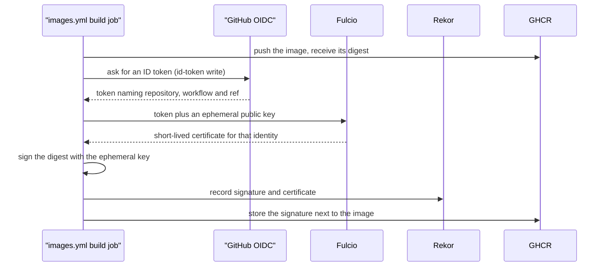
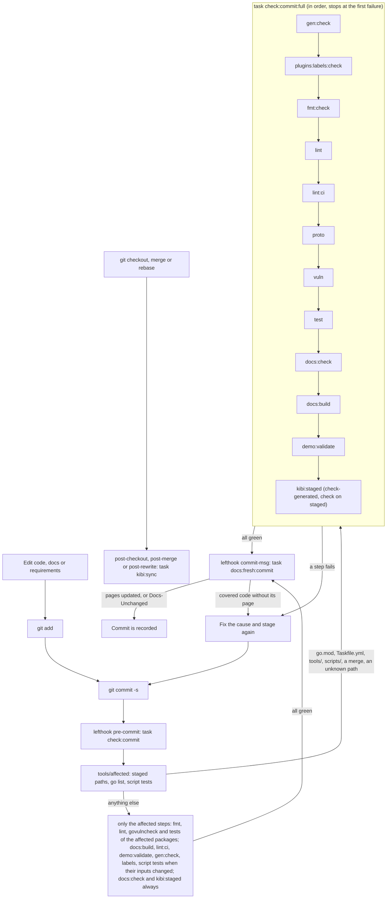
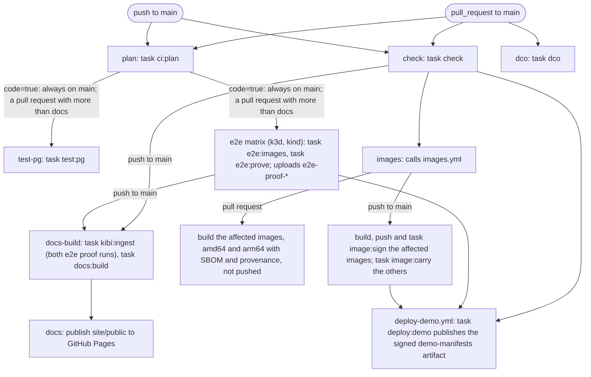
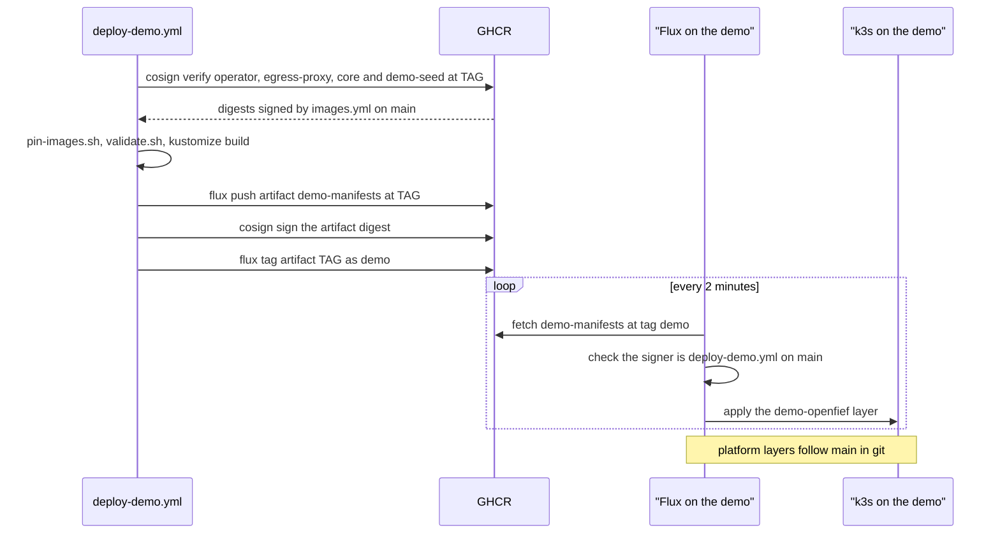
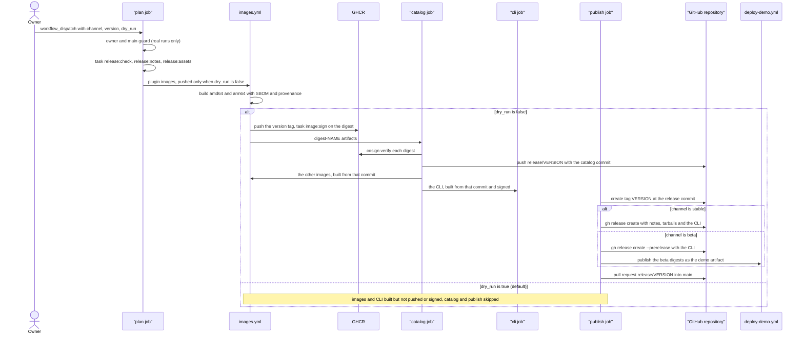

This page explains the machinery that takes a change from a commit on a branch to signed container images, a tagged release and the demo environment. It describes what the repository contains today, file by file. The rules this machinery enforces are in [sdlc.md](sdlc.md) and aren't repeated here. Where the two disagree, [Not built yet](#not-built-yet) says so.

## Concepts

**One entry point.** Make, written by Stuart Feldman at Bell Labs in 1976, gave a project one file that names every build step. [Task](https://taskfile.dev) follows the same idea, with YAML instead of Makefile syntax. In OpenFief, [Taskfile.yml](../../Taskfile.yml) is the only place a command is written down. A developer, a git hook and a CI job all run `task <target>`, so they can't drift into three slightly different scripts. The Taskfile also pins the version of every tool it calls.

**Shift-left checks.** "Shift left" (Larry Smith, 2001) means running a check earlier, when a failure is still cheap. In git, the earliest point is the pre-commit hook: the commit doesn't exist until its checks pass. [lefthook](https://github.com/evilmartians/lefthook) manages the hooks. It writes small scripts into `.git/hooks` that read [lefthook.yml](../../lefthook.yml).

**Conventional Commits.** A commit subject has the form `type(scope)!: summary`, as in `feat(ledger): add lots`. The convention grew out of the Angular project's commit guidelines. The type tells a machine what kind of change a commit is, and `!` or a `BREAKING CHANGE:` footer marks a breaking one. Here, the type decides which section of the release notes a commit goes in.

**CalVer and SemVer.** Semantic Versioning (`MAJOR.MINOR.PATCH`) is a compatibility promise: only a new major version may break you. That matters to code that depends on an API. Calendar Versioning puts the date in the number, as Ubuntu's `24.04` does, which tells a user how recent a release is. The product uses CalVer (`2026.11.0`). The protobuf contracts and SDKs are meant to use SemVer.

**DCO.** The [Developer Certificate of Origin](../glossary.md#other-terms-and-abbreviations) came from the Linux kernel in 2004, after the SCO lawsuits made the origin of code a legal question. Each commit carries a `Signed-off-by: Name <email>` trailer (`git commit -s`), by which the author certifies they may contribute it. It's lighter than a contributor licence agreement: there's nothing to sign beyond the commit itself. D-5 in [DESIGN.md](../DESIGN.md) requires it.

**Keyless signing.** [cosign](../glossary.md#other-terms-and-abbreviations) is the signing tool of Sigstore, a Linux Foundation project launched in 2021. Classic signing needs a long-lived private key that someone must guard and rotate. Keyless signing replaces the key with an identity. The CI job asks GitHub for an OIDC token that names the repository, workflow and ref. Sigstore's certificate authority, Fulcio, exchanges it for a certificate that is valid for about ten minutes. cosign signs with a throwaway key and records the signature in Rekor, a public append-only log. A verifier checks who signed (the workflow identity) rather than which key.



**Digest pinning.** An image tag such as `:main` is a movable pointer. A digest (`@sha256:...`) is the hash of the content, so it changes if one byte changes. Pinning a digest means you run exactly what was tested and signed. Here, GitHub Actions are pinned by commit SHA, Dockerfile base images by digest, and cosign signs the digest the build produced. D-17 requires plugin images to be pinned by digest.

**GitOps.** In a push deploy, CI holds a credential for the cluster and runs `kubectl apply`. GitOps, a name Weaveworks gave the practice in 2017, turns this around: an agent inside the cluster pulls the desired state from a versioned source and keeps the cluster matching it. [Flux](https://fluxcd.io), a CNCF project that grew out of Weaveworks, is such an agent. Nothing outside the cluster needs a way in, and the source's history is the deploy log. The demo's Flux pulls from git and from a signed OCI artifact: a registry entry that holds manifests instead of an image.

**Supply-chain hygiene with Renovate.** Exact pins stop surprise upgrades, but they go stale. [Renovate](https://docs.renovatebot.com) is a bot that finds pinned versions and opens pull requests to bump them, so each upgrade is a reviewed and tested change. It can't see a pin it can't parse, so the Taskfile and workflows mark versions with `# renovate:` comments.

**Affected-only checks.** In a repository with many packages, most commits touch a few of them. Build systems such as Bazel and Pants (and `go test` itself, through its cache) avoid repeating work whose inputs didn't change: they know each target's inputs and rerun only the targets downstream of a change. OpenFief does the same with a small selector, [tools/affected](../../tools/affected/main.go). Go's import graph (`go list`) says which packages a changed package reaches; the selector reruns lint and tests for those, and nothing else. A change it can't place, or one that every check reads, such as `go.mod`, runs everything: a check skipped wrongly costs more than a check run needlessly.

**Traceability gate.** In safety-critical engineering, a traceability matrix links each requirement to the code that implements it and the test that verifies it. [kibi](kibi.md) keeps that record in `.kb/` and checks it with Prolog rules. Its gate in the pre-commit hook refuses a commit whose behavioral code has no owning requirement or no covering test.

## How it works

### The Taskfile

Every step is a task target, and `task --list` shows them with descriptions. Three conventions recur:

- **Pinned tools in `.bin/`.** The `vars` block pins golangci-lint, govulncheck, lefthook, Task itself, actionlint, controller-gen, Hugo, buf and its three generators (Go, Connect and the read API's OpenAPI), and for the demo hcloud, kustomize and gojq. The internal `tool:*` targets `go install` them into `.bin/`, and a `status` check skips the install unless the version changed. Go tools are built with the toolchain in `go.mod` (`GO_TOOLCHAIN`, now `go1.27.3`), because golangci-lint refuses code that targets a newer Go than it was built with. The envtest API server and etcd come from [envtest-assets.sh](../../scripts/envtest-assets.sh), which checks each archive against a pinned SHA-512. The flux CLI can't be built with `go install`, so `tool:flux` downloads its release archive and checks a pinned sha256. The k3s and Flux versions a demo machine installs are pinned here too, with their sha256 sums, and rendered into its cloud-init. The end-to-end suite reads two more pins: `CNPG_VERSION` with the sha256 of CloudNativePG's release manifest, which the internal `e2e:cnpg` target downloads into `.bin/e2e/` and checks, and `K3S_VERSION` again, as the k3s image of the k3d cluster (`task e2e:k3s-image`).
- **Explicit paths.** Tasks call `{{.BIN}}/golangci-lint`, not `golangci-lint`, so a global install can't shadow the pin.
- **Skip until it exists.** Some targets print "skipping" and succeed while their input is missing: `GO_GUARD` (no `go.mod`) and `PROTO_GUARD` (no `.proto` files). The pipeline was built ahead of the product. Today nothing skips: `go.mod` and the contracts in `proto/` exist, and `e2e` runs the suite in `test/e2e`.

Two targets drive a browser on demand and are in no check, since a check must not need Chromium: `task design:icons` renders the built-in UI's app icons from the Seal with [app-icons.mjs](../../scripts/app-icons.mjs) ([Design system](design-system.md)), and `task ui:browser` runs [ui-browser.mjs](../../scripts/ui-browser.mjs), which serves the UI over its in-memory fakes and checks it at phone and desktop width, its installability and its service worker, saving screenshots to `SHOTS` ([Built-in UI](../concepts/ui.md#verification)). Both find Chromium the way docs-diagrams.mjs does.

`task setup` runs once per clone. It installs the tools, runs `npm ci` for kibi, whose `postinstall` has patch-package apply the repository's kibi patch ([The kibi gate](#the-kibi-gate)), installs the lefthook hooks, and registers kibi's merge driver for the `.kb` files named in [.gitattributes](../../.gitattributes). CI runs `task setup:ci` instead, which skips lefthook and the merge driver and compiles the branch's knowledge base.

`check` (CI) and `check:commit:full` run the same steps in the same order, with two differences: CI also runs the docs staleness gate over the pushed range (`docs:fresh`; the hook's version runs at `commit-msg`), and the kibi step at the end differs. The hook's `check:commit` runs only the steps of `check:commit:full` that the staged change can affect, and falls back to all of them when in doubt ([Affected checks](#affected-checks)). Task runs a `cmds` list in sequence and stops at the first failure. "Each module" below means `GO_MODULES`: the core (`.`) and the Go SDK (`sdk/go`).

| Step | What it runs | Fails when |
|---|---|---|
| `gen:check` | `task gen` (controller-gen writes deepcopy code, [CRDs](../glossary.md#other-terms-and-abbreviations) and the operator's Role), then [gen-check.sh](../../scripts/gen-check.sh) | a regenerated file differs from the git index or is untracked |
| `plugins:labels:check` | [plugin-labels.sh](../../scripts/plugin-labels.sh) `check`; `task plugins:labels` writes the labels | a first-party plugin's `io.openfief.plugin.manifest` Dockerfile label, or a demo `Plugin`'s `spec.manifest`, differs from its `plugins/<name>/manifest.json` (D-42) |
| `fmt:check` | `golangci-lint fmt --diff` in each module (gofumpt with extra rules, goimports) | a file would be reformatted |
| `lint` | `lint:config` (`golangci-lint config verify`), then `lint:go` (`golangci-lint run`) in each module, with the `e2e` build tag so the end-to-end suite is linted too | any finding; [.golangci.yml](../../.golangci.yml) enables every linter except a commented list |
| `lint:ci` | actionlint on the workflows, with its shellcheck and pyflakes integrations off | a workflow error |
| `proto` | `buf lint`, `buf format --diff`, [proto-breaking.sh](../../scripts/proto-breaking.sh) (with the base's own `buf.lock`), [proto-check.sh](../../scripts/proto-check.sh) | a lint or format issue, a breaking change against the base, or a stale `sdk/go/gen` or `gen/openapi` (the read API's OpenAPI document, generated from its protobuf and `read_service.openapi-base.yaml`) |
| `vuln` | [vulncheck.sh](../../scripts/vulncheck.sh): govulncheck in each module, then `npm audit --audit-level=high` | a finding, or an unreachable vulnerability database |
| `test` | `test:go` (`go test ./...` with the envtest binaries) in each module, then `test:script` for each of the eighteen `scripts/tests/*.test.sh` | any failure |
| `docs:check` | [check-docs.sh](../../scripts/check-docs.sh) | an undefined or duplicate GR, D, P, T, OQ or R ID, or a changed ground-rule line |
| `docs:build` | [docgen](../../tools/docgen/main.go) writes the reference pages, then Hugo and [docs-diagrams.mjs](../../scripts/docs-diagrams.mjs) build the site ([docs.md](docs.md)) | a broken link, a diagram that doesn't render, or a docs page naming a kibi ID or task that doesn't exist |
| `docs:fresh` (CI only) | `git log` over the range from `DOCS_BASE`, piped into `docgen fresh` | covered code changed without a page covering it and without a `Docs-Unchanged:` trailer, or a Go package no page covers |
| `demo:validate` | [validate.sh](../../scripts/demo/validate.sh): `kustomize build` of `deploy/demo`, of every git path its Flux Kustomizations apply, and of `deploy/demo/openfief` | a layer doesn't build, an image isn't pinned by digest, an OCI source doesn't require a cosign signature, or a substituting layer uses a variable cloud-init doesn't define |
| `kibi:check` or `kibi:staged` | `kibi check` through kibi-check.sh (CI); `kibi check-generated --staged --changed-only` and `kibi check --staged` (hook) | a knowledge-base rule violation |

Two steps compare against a base revision: the ground-rule check reads `DOCS_BASE`, and `proto:breaking` reads `PROTO_BASE`, then `DOCS_BASE`. Both default to `HEAD`, which locally means "against the last commit". CI sets `DOCS_BASE` to the pull request's base.

### Affected checks

`task check:commit` runs [check-commit.sh](../../scripts/check-commit.sh). It writes the staged changes (`git diff --cached --name-status`) and both modules' package listings ([go-packages.sh](../../scripts/go-packages.sh): `go list -json`, once with the `e2e` tag and once without) to a temporary directory, and runs `tools/affected hook` on them. The tool prints the plan and the reason for every step it runs or skips, and lists the task targets on standard output; the script runs them in order and stops at the first failure. If the tool fails, the commit fails. `task check:plan` prints the plan without running it, and `FULL=1` (`FULL=1 git commit ...`, or `task check:commit FULL=1`) runs `check:commit:full`. The tool itself never runs git, go or task: the scripts collect their output, as docgen's Taskfile targets do.

The tool sorts each changed path by the first rule that matches it, in [classify.go](../../tools/affected/classify.go):

| Change | What the hook runs |
|---|---|
| `go.mod`, `go.sum`, `go.work`, `go.work.sum` (both modules), `.golangci.yml`, `Taskfile.yml`, `lefthook.yml`, `tools/`, `scripts/`, `proto/`, `buf.*`, generated code (`gen/`, `sdk/go/gen/`), `design/`, `package.json`, `package-lock.json`; a merge being committed; a file in no rule, package or test's reach; a Go file in a directory that is no package (a package removed or not yet listed); a path with whitespace | everything: `check:commit:full` |
| A Go file | its package is changed. Lint and `govulncheck` run on it and on every package that imports it, directly or not (reverse imports from `go list`); tests run on those and on every package whose tests import one of them. `fmt:check:files` checks the staged Go files. |
| A file a package embeds (`go:embed`, from `go list`'s `EmbedFiles`) | the same as a Go file of that package |
| Any other file under a package's directory (test data, a Dockerfile) | that package's tests |
| A path a package's Go files name as a relative literal (`"../../deploy/crds"`, `filepath.Join("..", "deploy")`) | that package's tests |
| A path a script test names as `$root/<path>` | that script test (`test:script`) |
| `docs/`, `site/`, root `*.md` and `LICENSE` | `docs:build` |
| `.kb/` | `docs:build` (its status pages read kibi) |
| `.github/` | `lint:ci` |
| `deploy/` | `demo:validate`; `gen:check` for `deploy/crds` and `deploy/operator` |
| A plugin's `manifest.json` or `Dockerfile`, or `deploy/demo/` | `plugins:labels:check` |
| `.claude/`, `.mcp.json`, `renovate.json` | nothing more: no check reads them |
| Operator code, through its imports | `gen:check` |
| A deleted file | `docs:build`, since a page may link to it |

`docs:check` (a second) and `kibi:staged` always run, and the commit-msg hook's `docs:fresh:commit` is unchanged. So a commit of docs or requirements alone runs `docs:check`, `docs:build`, `kibi:staged` and the staleness gate, and no Go step. Collecting the inputs and compiling the tool take a few seconds. Measured with `task check:commit` on this repository's 66 packages, a warm Go cache and other work on the machine:

| Staged change | Steps | Time |
|---|---|---|
| A page under `docs/` | docs:check, docs:build, kibi:staged | 3 minutes, almost all in docs:build |
| One plugin's `main.go` | fmt, lint, govulncheck and tests of that plugin; plugin-labels.test.sh, which reads `plugins/`; kibi:staged | 22 seconds |
| `internal/plugins/egress` (two packages import it) | fmt, lint, govulncheck and tests of 3 packages, kibi:staged | 30 seconds |
| `internal/kernel` (41 packages import it) | fmt, lint, govulncheck and tests of 41 packages, kibi:staged | 63 seconds |
| `go.mod` | check:commit:full | 7 minutes |

The hook is less strict than CI by design: CI's `task check` stays whole, and runs on every pull request and every push to `main`. Linting a subset of packages can miss a finding that needs other packages (`dupl` compares code across packages), and a test that reads a file through a path built at run time, rather than a literal, isn't rerun when that file changes. [testing.md](testing.md#stability) asks tests to name such files with literal paths.

### Git hooks

[lefthook.yml](../../lefthook.yml) defines five hooks. Each calls one task with `.bin/` first on `PATH`, so the pinned Task runs:

- `pre-commit` runs `task check:commit`, which runs only the checks the staged change affects ([Affected checks](#affected-checks)).
- `commit-msg` runs `task docs:fresh:commit` with the message file: the docs staleness gate on the staged files. It skips merge commits; CI checks the merged commits one by one.
- `post-checkout` runs `task kibi:sync` for a branch checkout (lefthook's `{3}` argument is `1`), not for a file checkout.
- `post-merge` runs `task kibi:sync`.
- `post-rewrite` runs `task kibi:sync` after a rebase, not after an amend.

kibi compiles one store per branch, and the sync hooks keep it in step with the branch you're on. kibi's own git hooks stay uninstalled, so lefthook alone owns `.git/hooks`.

The hook checks the working tree, not a clean copy of the index. Go tests, lint and the docs check read files on disk, so an unstaged edit can make a commit pass locally and fail in CI. Only `gen:check` and the kibi gate compare against the index.



### The kibi gate

On commit, `kibi:staged` runs two commands. `kibi check-generated --staged --changed-only` regenerates kibi's symbol manifest from the staged bytes and compares it with what is staged; it skips the work when no staged path can affect a symbol. `kibi check --staged` then runs kibi's rules on the staged change, including the rule that blocks a behavioral symbol with no `implements` requirement or no `covered_by` test. kibi's own help marks `--staged` as experimental.

In CI, the setup action sets `KIBI_BRANCH`, because `actions/checkout` leaves a detached HEAD and kibi won't write a store without a branch name. `setup:ci` then runs `kibi sync`, and `task check` ends with `kibi check` over the whole knowledge base. CI is therefore stricter than the hook: it also catches problems outside the staged change.

kibi 2.36's `kibi sync` ends its compiling Prolog process with a SIGTERM right after detaching the store, and publishes the store straight after, the suspected cause of stores published without some of their records under load ([Not built yet](#not-built-yet)). [patches/kibi-cli+2.36.0.patch](../../patches/kibi-cli+2.36.0.patch), applied by patch-package on every `npm ci` (package.json's `postinstall`, with `--error-on-fail --error-on-warn`, so a patch that no longer applies, or a kibi-cli at another version, fails the install), makes the sync wait up to 60 seconds for that process to halt on its own after `kb_detach`, and refuses to publish when the detach failed or the process had to be signalled. `task kibi:check` also runs `kibi check` through [kibi-check.sh](../../scripts/kibi-check.sh), as a stopgap kept until kibi fixes the defect upstream: the patch makes the defect rarer, not gone. When the check fails naming a compile defect, an authored relationship "missing from the compiled KB" or a duplicate row in the paginated entity projection, the script compiles the store again from the same files with `kibi sync --rebuild` and checks once more; that check's result is final. Any other failure is final at once, and a real authored problem, such as an endpoint declared in a file Git doesn't track, survives the recompile and still fails. The same applies after a merge: run `kibi sync --rebuild`, then `task kibi:check`.

### CI on pull requests and main

[ci.yml](../../.github/workflows/ci.yml) runs on pull requests to `main`, on pushes to `main`, and by hand (`workflow_dispatch`), which runs like a push. The workflow starts from `permissions: {}`, and each job asks only for what it needs. A newer push supersedes a running pull-request run, but runs on `main` always finish, one at a time, so every merge is built.

Each job first calls the composite [setup action](../../.github/actions/setup/action.yml). It installs Go from `go.mod`, installs Task at the Taskfile's `TASK_VERSION` and sets `KIBI_BRANCH`. Task is the one tool installed outside a task target, since no target can run before Task exists. By default the action also installs Node and runs `task setup:ci`; jobs that only need Task pass `tools: 'false'`.

- `plan` runs `task ci:plan`: `tools/affected ci` reads `git diff --name-status <base> HEAD` and prints `code=false` for a pull request whose every path is docs, requirements or agent configuration (`docs/`, `site/`, `.kb/`, root `*.md`, `LICENSE`, `.claude/`, `.mcp.json`, `renovate.json`), and `code=true` otherwise and on every push. `test-pg` and `e2e` run only with `code=true`, so a push to `main` always runs the whole suite.
- `check` runs `task check` with full history, whatever changed. `DOCS_BASE` is the pull request's base SHA, or the previous `main` (`github.event.before`) on a push.
- `test-pg` runs `task test:pg`. [test-pg.sh](../../scripts/test-pg.sh) starts a throwaway PostgreSQL from the runner's binaries on a Unix socket, each test creates a fresh database with every migration applied, and the server is removed afterwards. The same run loads the demo dataset end to end through `cmd/demo-seed`, and starts `cmd/core` on a fresh database to call its read API with a script token.
- `dco` runs on pull requests only: `task dco BASE=<base sha> HEAD=<head sha>`. [dco-check.sh](../../scripts/dco-check.sh) walks each non-merge commit in the range and requires a `Signed-off-by` trailer that matches the commit's author name and email exactly.
- `e2e` is a matrix over `k3d` and `kind` (D-12), and one failure doesn't cancel the other; it has 30 minutes. A third-party action creates the cluster. The k3d cluster runs the demo machine's k3s: the image `task e2e:k3s-image` names from `K3S_VERSION`, with flannel, k3s's built-in kube-router NetworkPolicy controller, the bundled Traefik and servicelb, and `--secrets-encryption`, as the machine's cloud-init sets it. kind runs its default CNI, kindnet, which also enforces NetworkPolicy. `task e2e:images CLUSTER=<k3d|kind>` then builds the `core`, `operator`, `egress-proxy` and `demo-seed` images, the built-in UI plugin's `ui` image and the `nbp-fx` plugin from the checkout with `docker build` ([e2e-images.sh](../../scripts/e2e-images.sh)), tags them `openfief.test/<name>:e2e` and loads all but the plugins, `nbp-fx` and `ui`, into the cluster (`k3d image import`, `kind load docker-image`), so a pull request tests its own code. The plugins go to the suite's registry instead: a `registry:3.0.0` container, pinned by digest, on the cluster's Docker network and published on `127.0.0.1:5000`. The operator reads it at its private address on that network over plain HTTP; containerd pulls plain HTTP only from localhost, so the script pulls each plugin image into every node with `ctr --plain-http` under the name the operator deploys, which asks for `IfNotPresent`. It writes both registry addresses to `.bin/e2e/registry.env`, which `task e2e` reads. The job sets up Node too, and `task e2e` installs the npm packages (`kibi:install`), for playwright-core. The job runs the suite as `task e2e:prove`: it compiles the branch's knowledge base and runs `kibi prove --integration e2e`, which records the workspace snapshot, runs `task e2e` (the command `.kb/proof/integrations.json` names for the `e2e` integration) and turns its exit code into a passing or failing receipt for each end-to-end test with a proof contract. kibi judges the run as a whole, so one failing end-to-end test fails every receipt of that run. The job uploads the run's `kibi.proof-run.v1` artifact, `.kb/proof/runs/e2e.json`, as `e2e-proof-k3d` or `e2e-proof-kind`, kept seven days. `task e2e` runs [assert-local-cluster.sh](../../scripts/assert-local-cluster.sh), which refuses any API server not on `127.0.0.1`, `localhost`, `0.0.0.0` or `[::1]`, fetches the CloudNativePG manifest, and runs `go test -tags e2e -v ./test/e2e/...` with the pinned kustomize first on `PATH`.

  The suite installs what the demo machine runs, in the order of its Flux layers: CloudNativePG at the operator version of the demo's chart, `deploy/crds`, the demo's database `deploy/demo/database` (on kind, a copy of the default storage class named `local-path`), the demo's app layer `deploy/demo/openfief` through `test/e2e/overlays/openfief`, which only swaps the images and admits the suite's client pod like `core-from-traefik`, with the demo's `ui` instance pointed at the UI's signed image in the suite's registry, and on k3s the demo's Ingress through `test/e2e/overlays/routes` (no TLS, a `.test` host). Before the app layer it signs the plugin images in the registry with a key made for the run (`cosigntest.Key`) and adds the public key to the `openfief-trusted-signers` ConfigMap, so the operator starts trusting it. It then checks that the core becomes available and answers `/readyz` through its Service and, on k3s, through Traefik; that a pod no policy admits can't connect; that the `demo-seed` Job completes; that a script token from `/core token issue` lists the three demo accounts, each valued through today; that a call without a token gets 401; and that the operator deploys `nbp-fx` with a `Plugin` and `PluginGrant`, verified and reported in its status, hardened, reachable from the core only, with an allow-list of the granted host, and gone again with its allow-list key once the `Plugin` is deleted; that the operator deploys the UI with its browser path and the core proxies `/login` to it, from a pod and, on k3s, through Traefik (D-81); and that `openfief enroll` forwards `localhost:8080` to the core and prints the first passkey's link, with which the runner's Chrome, driven by [passkey.mjs](../../test/e2e/passkey.mjs) with its virtual authenticator, creates a passkey, keeps the `__Host-` cookie on `http://localhost`, signs out and signs in again (D-80, D-85). On a failure the test logs lines starting `diagnostics:`: every pod and event, the core's NetworkPolicies, EndpointSlices and the Ingresses, the Plugins, PluginGrants, plugin Deployments, the allow-list and the trusted signers, the spec and status of the core's pods and of every pod that isn't ready, and the logs (with the previous run's) of every pod in `openfief`, `cnpg-system` and the clients' namespace, and of Traefik. A failed installation prints the same before any test runs.
- `images` waits for `check` and calls [images.yml](../../.github/workflows/images.yml) with `select`, so only the images the change affects are built, and with `push` true only on `main`. A manual run with `all_images` rebuilds every image.
- `docs-build` runs on a push to `main` once `check` and both `e2e` jobs passed, with `contents: read` only. It downloads the two `e2e-proof-*` artifacts into `.kb/proof/runs/ci`, which Git ignores and kibi leaves out of the workspace snapshot, and runs `task kibi:ingest`: [kibi-ingest-proofs.sh](../../scripts/kibi-ingest-proofs.sh) hands each artifact to `kibi ingest-proof`, oldest first, since kibi keeps a test's receipts in the order their runs finished. kibi accepts an artifact only when it was made from the same workspace snapshot, by the configured command, so the receipts come from the real runs of this commit. `task docs:build` then renders the site, kibi's requirements report included, and the job uploads `site/public` as a Pages artifact. A failing end-to-end run leaves the site at the last commit whose runs passed.
- `docs` publishes that artifact with GitHub's `deploy-pages` action to the `github-pages` environment ([docs.md](docs.md)); only this job has `pages: write` and `id-token: write`. It needs the repository's Pages source set to "GitHub Actions", with the custom domain `openfief.dev`. With "Deploy from a branch", the deploy fails with a 404 and GitHub serves the repository root through Jekyll instead.
- `deploy-demo` runs on every push to `main`, after `check`, `e2e` and `images` succeed. It has no on/off variable: publishing the artifact is harmless without a demo machine, because nothing pulls it. It calls [deploy-demo.yml](../../.github/workflows/deploy-demo.yml), described in [The demo](#the-demo).



**Images.** The `discover` job runs `task ci:images`. It lists each `cmd/<name>/Dockerfile` and `plugins/<name>/Dockerfile` as a JSON matrix and lowercases the registry prefix; today that is `core`, `demo-seed`, `egress-proxy` and `operator`, and the plugins `eodhd`, `ghostfolio`, `ibkr-flex`, `nbp-fx`, `treasury-bonds` and `ui`. An empty list skips `build` rather than failing it.

With `select` (CI, never a release), `discover` runs `task ci:images:select` instead ([ci-images-select.sh](../../scripts/ci-images-select.sh)), which hands `tools/affected images` the matrix, the package listings and, per image, an earlier build to compare with. An image is affected by its Dockerfile, by a non-test Go file of any package its binary imports, directly or not (from `go list`, so not from paths alone), by a file one of those packages embeds, and by the inputs every image shares: both modules' `go.mod` and `go.sum`, `go.work`, `go.work.sum`, `.dockerignore`, images.yml, the setup action, ci-images.sh and `tools/affected`. A Go file in no package rebuilds every image.

- On a pull request (`base`), the earlier build is the pull request's base: the affected images are built, not pushed, and the rest are skipped.
- On `main` (`reuse`), the earlier build is the newest of HEAD's last 20 first-parent commits whose `sha-<commit>` tag carries a signature that `cosign verify` accepts from images.yml on `main`, the identity [pin-images.sh](../../scripts/demo/pin-images.sh) trusts. Comparing with that commit, not with the push's `before`, means a cancelled run or a failed build can't hide a change: the next run diffs against the last image that was really signed. An image with no such build is built.
- An unaffected image on `main` is carried: the `carry` job runs `task image:carry` ([image-carry.sh](../../scripts/image-carry.sh)) per image. It verifies the earlier digest's signature, tags that digest `sha-<commit>` and `main` with `crane tag` (pinned as `CRANE_VERSION`), which adds a tag without touching the manifest, and verifies that the new `sha-<commit>` tag resolves to the same signed digest. Nothing new is signed: the signature from images.yml on `main` belongs to the digest. So after every push, every image has a `sha-<commit>` tag on a digest images.yml signed, and the demo deploy finds one for each image as before. A carry that fails fails the run, and the deploy with it.

`discover` prints its decision and the reason for each image in the job log, such as `carry nbp-fx: no input changed since 1a2b3c4` or `build core: internal/ledger/ledger.go is in internal/ledger, which it imports since 1a2b3c4`. `build` runs once per image. Buildx builds `linux/amd64` and `linux/arm64` from the repository root, attaches an SBOM and a full (`mode=max`) provenance attestation, and caches layers per image. The Dockerfiles copy `go.work`, `go.work.sum` and `sdk/go` and build in workspace mode, as the repository does locally, because the core imports the SDK module, which a private repository can't serve as a module version. They cross-compile Go on the build machine and copy the binary into a distroless base pinned by digest. When pushing, the job logs in to GHCR with the job's token, pushes, and runs `task image:sign IMAGE=<image>@<digest>`, so cosign signs the digest just pushed, never a tag. cosign v3 stores the signature as a Sigstore bundle attached to the digest as an OCI referrer. The operator verifies plugin images in that format and trusts `images.yml` on `main` as OpenFief's own signer, so signing has to stay in that workflow. The tags depend on the caller:

| Caller | Built | Pushed and signed | Tags |
|---|---|---|---|
| Pull request | the affected images | no | none |
| Push to `main` | the affected images; the others are carried | yes; a carried image keeps its signed digest | `sha-<short sha>` and `main`, on a new or a carried digest |
| Manual run with `all_images` | every image | on `main` | `sha-<short sha>` and `main` |
| Release | every image | yes, unless `dry_run` | the version, such as `2026.11.0-beta.1` |

### The demo

The demo is one Hetzner Cloud server running k3s, holding synthetic data only (GR-12). [demo.md](demo.md) is the operator's guide; it's a proposal, and this section only explains the machinery. The pipeline touches the demo in two ways.

**The machine.** `demo:plan`, `demo:up`, `demo:status`, `demo:down` and `demo:recreate` all run [demo.sh](../../scripts/demo/demo.sh) with the pinned hcloud CLI. They run from a terminal, or from [demo-infra.yml](../../.github/workflows/demo-infra.yml), a hand-started workflow in the GitHub Environment `demo`, which holds `HCLOUD_TOKEN` and `CLOUDFLARE_API_TOKEN`. The script keeps no state: it finds Hetzner resources by the labels `app=openfief` and `env=<name>`, and Cloudflare DNS records by the comment `managed-by=openfief-demo env=<name>`, so `up` creates only what is missing and `down` deletes only what is the demo's. With the Cloudflare token, `up` points `demo.openfief.dev` (an A and a CAA record) at the server, through curl and gojq; without it, `up` prints the record to create, and `DEMO_DOMAIN=none` falls back to an sslip.io name. `task dns:site` (`demo.sh dns-site`) keeps the website's records at `openfief.dev` and `www` the same way, under its own comment `managed-by=openfief-site`, and deletes the retired `docs.` record. When the project has no SSH key labelled `openfief-ssh=true`, `up` installs a throwaway public key whose private half is never stored, so Hetzner sets no root password. Before it creates anything, it prices the server and its IPv4 from Hetzner's price list in integer micro-euros. It refuses if the monthly total of all OpenFief resources would exceed `DEMO_BUDGET_EUR`, which defaults to 10 EUR. `down` and `recreate` need `CONFIRM` set to the demo's name. The server boots from [cloud-init.yaml](../../deploy/demo/cloud-init.yaml), filled in with the Taskfile's pins. It installs k3s and Flux, checking each download's sha256, and points Flux at `deploy/demo` on `main`.

**Deploys.** Nothing outside the machine holds a credential for the cluster. Flux follows two kinds of source, declared in [stack.yaml](../../deploy/demo/stack.yaml). The platform layers follow `main` in git: the CRDs, the CloudNativePG operator and database, cert-manager and the Let's Encrypt issuer. OpenFief itself, today the operator, the egress proxy, the core, the demo's plugin instances and the `demo-seed` Job that loads the synthetic demo dataset ([demo.md](demo.md#demo-data)), follows a signed OCI artifact, and so do the demo's routes to it, so a route never changes before the core it points at. [deploy-demo.yml](../../.github/workflows/deploy-demo.yml) publishes it by running `task deploy:demo TAG=<tag> REPO=<owner/repo>`, where the tag is `sha-<short commit>` for `main` or the version for a beta:

1. [pin-images.sh](../../scripts/demo/pin-images.sh) runs `cosign verify` on each image at that tag. It accepts only a signature from `images.yml` on `main`, and writes the verified digest over the all-zeros placeholder in `deploy/demo/openfief/kustomization.yaml`. One unverified image fails the deploy. A carried image's `sha-<commit>` tag points at a digest an earlier run signed, so it verifies like a fresh one.
2. validate.sh checks the result, and kustomize renders it into the artifact's `app/`, and `deploy/demo/routes` into its `routes/`.
3. `flux push artifact` pushes the manifests to `ghcr.io/<owner>/<repo>/demo-manifests:<tag>`. cosign signs that digest keylessly, and `flux tag artifact` moves the `demo` tag to it.
4. Flux on the machine checks the `demo` tag every two minutes. It applies a new artifact only if the signature comes from `deploy-demo.yml` on `main`.

The deploy job runs in the `demo` environment with `packages: write` and `id-token: write` and no secret. A concurrency group makes deploys queue instead of overlapping.



### Releases

[release.yml](../../.github/workflows/release.yml) only starts by hand (`workflow_dispatch`) and takes three inputs: `channel` (`beta` or `stable`), `version`, and `dry_run`, which defaults to `true`. Only one release runs at a time.

1. `plan` refuses a real run unless the actor is the repository owner and the ref is `main`. It then runs three tasks on full history. `release:check` calls [release-version.sh](../../scripts/release-version.sh): stable must be `YYYY.M.N` and beta `YYYY.M.N-beta.K`, with no `v`, no leading zeros, a month from 1 to 12, `K` from 1 up, and no existing tag. `release:notes` writes the notes to the run's summary page. `release:assets` packs `deploy/` into `dist/openfief-deploy-<version>.tar.gz` and builds the docs site into `dist/openfief-docs-<version>.tar.gz`; these copies are only a trial and are discarded.
2. `plugin-images` calls images.yml with `kind: plugins`: only `plugins/*/Dockerfile`, with the version as the tag, pushed and signed only on a real run. Each pushed image's digest becomes an artifact, `digest-<name>`.
3. `catalog` runs only on a real run (D-88). `task release:catalog` ([release-catalog.sh](../../scripts/release-catalog.sh)) checks each digest's keyless signature by `images.yml` on `main` with `cosign verify`, then adds one entry per first-party plugin to [plugins.json](../../internal/plugins/catalog/plugins.json): its name, the release version, `ghcr.io/<repo>/<name>@<digest>` and the publisher `openfief` with OpenFief's CI identity. It refuses a plugin without a digest and a name and version already listed. The job commits the file on a new branch, `release/<version>`, and pushes it; that commit is the release commit.
4. `images` calls images.yml with `kind: commands` and `ref` set to the release commit, so the operator and core embed the catalog that pins this release's plugins. On a dry run there is no release commit and it builds the dispatching commit.
5. `cli` builds the `openfief` CLI from the release commit with `task release:cli` ([release-cli.sh](../../scripts/release-cli.sh)): static binaries for Linux and macOS on amd64 and arm64, `openfief-<version>-<os>-<arch>`, a CycloneDX SBOM from `cyclonedx-gomod` (pinned in the Taskfile) and `openfief-<version>-SHA256SUMS`. On a real run `task release:cli:sign` signs every file keylessly with `cosign sign-blob`, writing a Sigstore bundle, `<file>.sigstore.json`, next to it; the certificate names `release.yml` at `refs/heads/main`. The files are the run's `cli` artifact.
6. `publish` runs only on a real run, on the release commit. `task release:publish` repeats the version check, rebuilds the tarballs and notes, and creates the tag at that commit through the GitHub API. For `stable` it creates a GitHub release with the notes, both tarballs and the CLI files; a beta gets a pre-release with the notes and the CLI files only. It then opens a pull request from `release/<version>` to `main`, so the catalog reaches `main` through review rather than a direct commit.
7. `deploy-demo` runs after every real beta. It publishes the beta's verified digests as the demo artifact, as above, with the version as the tag.

[release-notes.sh](../../scripts/release-notes.sh) finds the previous release with `git describe`, limited to tags that start with four digits. A stable release skips beta tags, so its notes cover the whole cycle; a beta starts after the newest release of either channel. Each non-merge commit goes into Breaking changes (`!` or a `BREAKING CHANGE:` footer), Features (`feat`), Fixes (`fix`), Performance (`perf`) or Other changes, which also takes anything not in Conventional Commit form.



### Pins and Renovate

[renovate.json](../../renovate.json) enables four managers: Go modules, npm, GitHub Actions, and a regex manager for `# renovate:` comments in Taskfile.yml and `.github/`. `rangeStrategy: pin` keeps versions exact, and `helpers:pinGitHubActionDigestsToSemver` pins each action to a commit SHA with the version as a comment. Updates are grouped into one PR each for Actions, kibi, Taskfile tools, CI toolchains and Go modules. Renovate commits as `build(deps): ...` with a `Signed-off-by` line, so its PRs pass the DCO check and land under Other changes in the release notes.

| What | Pinned in | Kept current by |
|---|---|---|
| Go toolchain | `toolchain go1.27.3` in both `go.mod` files; `golang:1.27.3` by digest in the Dockerfiles | Renovate for `go.mod`; nothing for the Dockerfiles |
| Go dev tools, including Hugo, hcloud, kustomize and gojq | Taskfile `vars` | Renovate, "Taskfile tools" |
| kibi, Mermaid, playwright-core, patch-package | exact versions in [package.json](../../package.json), plus `package-lock.json` | Renovate (npm); kibi as one group, and a kibi-cli bump fails `npm ci` until the patch in `patches/` is moved to it or dropped |
| flux CLI; k3s and Flux on the demo machine | Taskfile `vars`, each with sha256 sums | Renovate bumps the version; the sums by hand ([demo.md](demo.md#update-the-pinned-versions)) |
| Demo Helm charts (CloudNativePG, cert-manager) | `deploy/demo/*/helmrelease.yaml` | nothing |
| Actions | a commit SHA in each `uses:` | Renovate, "GitHub Actions" |
| Node, k3d, kind | the setup action and ci.yml, with `# renovate:` comments | Renovate, "CI toolchains" |
| envtest binaries | `ENVTEST_K8S_VERSION` plus SHA-512 sums in envtest-assets.sh | by hand |
| Protobuf dependencies (googleapis, for the read API's HTTP rules) | `buf.lock`, by commit and digest; buf fetches them from the Buf Schema Registry | by hand (no Renovate manager for buf) |
| Sigstore trust root the operator verifies against | `internal/plugins/cosign/trusted_root.json` | `task trustroot:update`, by hand: it fetches the root through TUF, and the diff is reviewed |
| Base images | digests in `cmd/*/Dockerfile` | nothing (see below) |
| kubectl, gh, Buildx, QEMU, Chrome (docs diagrams), PostgreSQL (`test:pg`) | the runner image and the actions' defaults | not pinned here |

## Verification

The pipeline's decisions live in shell scripts, and each script that decides something non-trivial has a test in [scripts/tests](../../scripts/tests). Each test works in a throwaway directory or git repository from `mktemp`. The git tests also clear `GIT_DIR` and its siblings, which a hook exports, so they can't touch the real repository. Each test is a kibi test record that covers a tooling requirement. `task test` runs all nineteen in CI; the hook runs those that read a changed path, and all of them when `scripts/` changes. The selector's own decisions are table tests in [tools/affected](../../tools/affected/plan_test.go): change sets mapped to hook steps, images built or carried, and CI jobs (TEST-tooling-affected-plan, TEST-tooling-affected-images, TEST-tooling-affected-inputs).

| Test | Proves |
|---|---|
| `check-docs.test.sh` (TEST-tooling-docs-check) | Unchanged docs pass; a reference to an undefined ID, an edited ground-rule line, an ID defined twice and a base revision that isn't a commit each fail with the right message. |
| `vulncheck.test.sh` (TEST-tooling-vuln-offline) | A high npm finding fails, an unreachable npm registry fails, and a govulncheck that can't reach `vuln.go.dev` fails. Stubs keep it offline. |
| `ci-images.test.sh` (TEST-tooling-ci-images) | No Dockerfile gives `[]`; two Dockerfiles give the expected matrix with a lowercased prefix; `plugins` and `commands` list one kind each and an unknown kind fails; a duplicate or invalid image name fails. |
| `plugin-labels.test.sh` (TEST-tooling-plugin-labels) | The committed labels pass; a manifest changed without its label fails and names the Dockerfile; a demo `Plugin` declaring another manifest fails; `write` brings the label in step, keeps backslashes as they are, appends the label to a Dockerfile without one, and refuses a single quote or a missing Dockerfile. |
| `release-catalog.test.sh` (TEST-tooling-release-catalog) | Each plugin enters the catalog with its digest, the version and OpenFief's CI as publisher, lowercased; a plugin without a digest, a digest that isn't one and a name and version already listed fail; a next version keeps the earlier entries. |
| `release-cli.test.sh` (TEST-tooling-release-cli) | With stand-ins for go and cyclonedx-gomod: four static builds, Linux and macOS on amd64 and arm64, named by version, an SBOM, and a SHA256SUMS that lists and verifies them all. |
| `dco-check.test.sh` (TEST-tooling-dco) | A commit signed off by its author passes; a sign-off by someone else and a missing sign-off both fail and name the commit. |
| `release-version.test.sh` (TEST-tooling-release-version) | 14 table cases: valid stable and beta versions pass; a `v` prefix, leading zeros, month 13, `beta.0`, the wrong or an unknown channel, and an existing tag fail. |
| `release-notes.test.sh` (TEST-tooling-release-notes) | Stable notes start after the previous stable, beta notes after the previous release of either channel, a first release covers all history, and both `!` and `BREAKING CHANGE:` count as breaking. |
| `proto-breaking.test.sh` (TEST-tooling-proto-breaking) | A base without contracts passes; adding a field passes; changing a field's type fails and names it; `PROTO_BASE` and `DOCS_BASE` both select the base. Needs `buf` on `PATH`. |
| `demo.test.sh` (TEST-tooling-demo) | 199 checks against a fake hcloud with synthetic prices, and a fake curl that plays the Cloudflare DNS API on a record file. DNS records are created, updated in place on a new IPv4, left alone on a second run, and deleted only when they carry the demo's comment; a record set by hand at the demo's name is refused; without a Cloudflare token the demo falls back to sslip.io. Without a labelled SSH key, only a throwaway Ed25519 public key is uploaded, and `down` deletes it. `demo.sh dns-site` creates the apex's Pages A and AAAA records and the `www` CNAME, changes nothing on a second run or over matching records made by hand with its comment, reconciles a changed address list exactly, adds the verification TXT only with `GITHUB_PAGES_CHALLENGE`, deletes the retired `managed-by=openfief-docs` record, refuses a foreign record at the apex or `www`, and never touches the demo's records, nor the demo its records. A missing token is refused before any API call. `plan` prices the server and IPv4 and creates nothing. `up` over budget is refused, counting existing resources; otherwise it creates the firewall before the server, with labels, keys and rules, and a second `up` creates nothing. `down` needs the matching `CONFIRM`. The rendered cloud-init pins k3s for the CPU, leaves no placeholder and holds no token. |
| `demo-pin-images.test.sh` (TEST-tooling-demo-pin-images) | With a fake cosign: signed images get their digests, the demo's `Plugin`s, `nbp` and `ui`, render with their pinned plugin images, and comments survive; only `images.yml` on `main` is trusted; an unsigned image fails and keeps its placeholder; a malformed tag or digest is refused. |
| `demo-validate.test.sh` (TEST-tooling-demo-validate) | The committed manifests pass; an OCI source without cosign verification, an image pinned by tag only, a Flux path that doesn't build and an undefined substitution variable each fail. |
| `check-commit.test.sh` (TEST-tooling-check-commit) | With a fake go and task: the plan's steps run in order, a variable with spaces stays one argument, and a step reading standard input can't swallow the next; the tool gets the staged changes and both modules' listings; a failing step stops the rest and fails the hook; a failing selector runs nothing; `FULL` and a merge being committed run the full check; `DRY_RUN` runs nothing. |
| `ci-images-select.test.sh` (TEST-tooling-ci-images-select) | With a fake cosign and go: `reuse` finds each image's newest signed `sha-<commit>` build, HEAD first, stops at the first, finds none for an image never signed, and hands over the diff since; `base` compares every image with the base and verifies nothing; `all` compares with nothing; a bad repository, revision or mode is refused. |
| `kibi-check.test.sh` (TEST-tooling-kibi-check) | With a fake kibi: a valid KB passes with one check; an authored violation fails at once; a missing compiled relationship or a duplicate projection row recompiles once and the second check decides; a defect that survives the recompile fails, with no third try. |
| `kibi-ingest-proofs.test.sh` (TEST-tooling-kibi-ingest-proofs) | With a fake kibi: no artifact fails without calling kibi; two clusters' artifacts are ingested whole, each with its own snapshot, the earlier finished first; an artifact kibi refuses fails the script before the next one. |
| `image-carry.test.sh` (TEST-tooling-image-carry) | With a fake crane, cosign and registry: a signed digest gets `sha-<commit>` and `main`, checked after tagging; an unsigned digest is refused before any tag is written; a tag that resolves to another digest fails; malformed arguments are refused before anything runs. |
| `gateway.test.sh` (TEST-deploy-gateway-component) | The overlay [Expose OpenFief](../guides/expose.md) shows, with the Gateway component, builds: one HTTPRoute to the core's `http` port on the owner's Gateway and hostname, a NetworkPolicy admitting the Gateway's proxies to port 8080 alone, the route's origin in `--auth-origin`; the core base alone has no route and admits plugin pods to port 8081 only (D-28, D-115). |

To run them and the other self-checks:

```sh
task check:plan                # what the hook would run for the staged change, and why
task test                      # Go tests plus the eighteen script tests
bash scripts/tests/dco-check.test.sh
PATH="$PWD/.bin:$PATH" bash scripts/tests/demo.test.sh
task lint:ci                   # actionlint over the workflows
task gen:check                 # regenerate, then fail on drift
task proto                     # buf lint, breaking and generated-code checks
task demo:validate             # build every demo layer offline; digests and signatures
task demo:plan ENV=demo        # read-only Hetzner (and Cloudflare) API calls; needs HCLOUD_TOKEN
task ci:images PREFIX=ghcr.io/arkadiuss/openfief
task release:check CHANNEL=beta VERSION=2026.11.0-beta.1
task release:notes VERSION=2026.11.0
task dco BASE=origin/main HEAD=HEAD
```

actionlint checks the workflows only statically. To exercise the release workflow without publishing, dispatch a dry run with `gh workflow run release.yml -f channel=beta -f version=2026.11.0-beta.1 -f dry_run=true`, and read the notes on the run's summary page. To check what was published, verify the signatures with the identities the pipeline itself trusts, and read an image's SBOM:

```sh
cosign verify ghcr.io/arkadiuss/openfief/operator:main \
  --certificate-oidc-issuer https://token.actions.githubusercontent.com \
  --certificate-identity https://github.com/arkadiuss/openfief/.github/workflows/images.yml@refs/heads/main
cosign verify ghcr.io/arkadiuss/openfief/demo-manifests:demo \
  --certificate-oidc-issuer https://token.actions.githubusercontent.com \
  --certificate-identity https://github.com/arkadiuss/openfief/.github/workflows/deploy-demo.yml@refs/heads/main
docker buildx imagetools inspect ghcr.io/arkadiuss/openfief/operator:main --format '{{ json .SBOM }}'
```

pin-images.sh trusts the first identity and Flux the second. Both assume that Fulcio names the reusable workflow that ran the job, not the workflow that called it; this page hasn't been checked against a real certificate. On the machine, `flux get sources oci` and `flux get kustomizations` show what Flux verified and applied ([demo.md](demo.md#reach-the-demo)).

Nothing tests [assert-local-cluster.sh](../../scripts/assert-local-cluster.sh), gen-check.sh, proto-check.sh, envtest-assets.sh, test-pg.sh or go-packages.sh, a demo machine's boot, or the tasks only CI runs: `image:sign`, `deploy:demo` as a whole and `release:publish`. `crane tag` and the carry job have only run against fakes here; that `crane tag` keeps the digest is what crane documents, and image-carry.sh checks it on every carry.

## Not built yet

These are the gaps between [sdlc.md](sdlc.md) or [testing.md](testing.md) and the files, plus things that look broken.

- **Local green isn't always CI green** (sdlc.md:10). The hook runs only the checks a change affects ([Affected checks](#affected-checks)), and ends with `kibi:staged`, while CI runs the whole `task check` and checks the whole knowledge base. DCO and the PostgreSQL tests run only in CI; the `commit-msg` hook runs only the docs gate. The hook reads the working tree, so unstaged edits count. Vulnerability databases change between runs.
- **A failing PostgreSQL test doesn't stop the demo deploy.** `deploy-demo` needs `check`, `e2e` and `images`, but not `test-pg` (ci.yml:161).
- **Not everything goes through a task target** (sdlc.md:17). Docker's actions build and push images inside images.yml; only `e2e:images` builds images through a task target, for the local cluster. Third-party actions also create the e2e clusters and publish the docs site.
- **Not every tool is pinned in the Taskfile** (sdlc.md:18). Node, k3d and kind are pinned in the workflows, the demo's Helm charts in `deploy/demo`, the e2e client image (curl) by digest in `test/e2e/testdata`, and the e2e registry image by digest in `scripts/e2e-images.sh`. The k3d cluster's k3s image is named by tag from `K3S_VERSION`, not by digest, and CloudNativePG's manifest, pinned by sha256, names its operator image by tag. kubectl, gh, Buildx, QEMU, the Chrome that renders docs diagrams and the PostgreSQL that `test:pg` starts come from the runner image or the actions' defaults.
- **`task vuln` ignores low and moderate npm findings** (sdlc.md:19 says any finding). vulncheck.sh:24 passes `--audit-level=high`, and the test covers only a high finding.
- **Conventional Commits aren't enforced** (sdlc.md:25). Nothing lints commit messages or PR titles, and a non-conforming commit lands under Other changes.
- **No PR template** asks which requirements a PR implements or how it was verified (sdlc.md:26).
- **End-to-end tests cover the demo stack only** (testing.md, sdlc.md:11 and :31). The suite runs two plugins through the operator (`nbp-fx`, configured to call nothing outside, and the UI), no real Ghostfolio and no fixture server, and goes through no bootstrap install other than the demo's manifests. The demo loader fetches NBP rates from api.nbp.pl when the runner reaches it and falls back to its committed rates otherwise, so the suite isn't hermetic. kind has no Traefik, so the route through Traefik is checked on k3d only. The local-cluster guard has no test, though REQ-tooling-e2e-local-only has a scenario.
- **Most of P-10's acceptance criteria aren't verified end to end** (kibi.md, testing.md). P-10 is still a proposal, and each criterion becomes a scenario verified end to end when its area is built. Today the suite verifies only parts of four, each a scenario on its end-to-end test with an `acceptance:p10-<n>` tag: 7, the read API refuses a call without a token (SCEN-e2e-read-api-needs-token); 8, the first passkey is created and used on `localhost` (SCEN-e2e-first-passkey-localhost); 17, only the core reaches a connector's pod (SCEN-e2e-plugin-only-core-calls); 18, deleting a plugin removes its workload and allow-list entry (SCEN-e2e-plugin-uninstalled). Not built: 1 consolidation, 2 double-entry over the whole log, 3 idempotent versioned imports, 4 opening lots, 5 bond values against a reference, 6 prices and FX with the tolerance check, 9 Ghostfolio, 11 the operator's refusals (no grant, tag, signature, upgrade waiting for a grant, verified only when catalog-pinned), 12 operator scope, 13 exposure (the suite installs the demo's route), 14 secrets, 16 egress through the proxy's logs, 19 the model portfolio; and the rest of 7 (the OpenAPI spec, every resource, no write endpoint, the Connect clients), 8 (a second hostname, the charts through the read API), 10 (the XTB parser's missing egress, refused hosts and bypasses), 17 (a core call without a valid token) and 18 (grant and Secrets, transactions marked as from a removed instance). 15, the whole acceptance suite on kind and k3d, holds for today's suite only.
- **The demo serves no product yet** (sdlc.md:12 and :32). The deploy path is built, but whether it runs depends on settings outside the repository: the `demo` environment and public GHCR packages. The app layer holds the operator and the egress proxy, and `demo-routes` stays suspended until a core service exists (deploy/demo/stack.yaml:107). The demo database stays empty too: deploy/demo-data/kustomization.yaml:2 says `deploy/demo` includes the seed Job, but nothing under `deploy/demo` refers to it, and `deploy/demo/openfief` doesn't pin the `demo-seed` image.
- **Releases don't pin their core images** (sdlc.md:41, D-17). images.yml records only each image's digest as an artifact, which the catalog uses for the plugins. The stable tarball ships `deploy/` with bases that name images without a tag or digest (deploy/operator/deployment.yaml:28, deploy/egress-proxy/deployment.yaml:26) and expect an overlay to pin them. Only the demo has such an overlay, and CI fills it in at deploy time. "The CRDs and the bootstrap install" are one archive of `deploy/`.
- **The dry run is per run, not a gate** (sdlc.md:42). A run with `dry_run: false` validates in `plan`, then pushes and signs images straight away (release.yml:73-83). Nothing requires an earlier dry run of the same commit, or checks that the commit passed CI. Because image builds don't fail fast, one image can be pushed while another fails, which leaves pushed images with no tag.
- **No SDK or contract releases** (sdlc.md:43). There's no `sdk/go/vX.Y.Z` tagging and no TypeScript SDK. `buf breaking` now has contracts to check (the connector contract and the read API) and runs on every change, not only before an SDK release.
- **Renovate misses some pins** (sdlc.md:47). `enabledManagers` (renovate.json:5) lacks `dockerfile`, yet cmd/operator/Dockerfile:3, cmd/egress-proxy/Dockerfile:3 and cmd/demo-seed/Dockerfile:5 say Renovate updates them, so `golang:1.27.3` can drift from `go.mod`'s toolchain. No manager reads the demo's Helm chart versions. For k3s and Flux, Renovate bumps the version but not the sha256 sums beside it: a stale flux CLI sum fails the next deploy job, while stale k3s or Flux install sums show up only when a machine boots and stops at that download.
- **kibi's compile isn't deterministic.** On an unchanged tree, `kibi sync --rebuild` followed by `kibi check` failed 3 times in 30 runs here, with three clones of the same commit compiling at once on four CPUs: each time one to three relationships present in `.kb/relationships/` were missing from the published store (for example `verified_by SCEN-ledger-seed-concurrent->TEST-ledger-app-seed`). Rechecking the same store, on the same engine or after `kibi engine stop`, failed the same way, so the store on disk is wrong, not the running engine; the next compile of the same files passed. Each clone has its own store and its own engine socket (keyed by workspace and branch under `/tmp/kibi-runtime`), so worktrees don't share state: load, not sharing, is what the failures had in common. The CI failure on eaf5189 (`Full KB paginated entity projection returned duplicate entity ID`) reads as the same defect from the other side: `kb_query_entities` sorts unique ids, so a duplicate row means the store held one entity twice. The suspected cause was that `kibi sync` ends its compiling Prolog process with a SIGTERM right after `kb_save` and `kb_detach` (`terminate()` with no grace period) and publishes the staging directory straight after. The repository's patch ([The kibi gate](#the-kibi-gate)) lets that process halt on its own first, and in the same stress run, three clones each looping `kibi sync --rebuild` and `kibi check` twelve times, failures fell from 9 of 36 checks without the patch to 2 of 36 with it, every one of them a relationship missing from the compiled store. The patch makes the defect rarer but doesn't remove it, so the termination isn't the only cause; the sync's own count of the staging store before saving matched the authored files even in failing runs, which puts the loss between saving the store and the next check reading it. kibi-check.sh therefore stays: it recompiles once on such a failure, so a defect fails the gate only when two compiles in a row hit it. The report for kibi's author, with the patch as a partial fix, waits for the author's review before it is filed.
- **Smaller issues.** The setup action's "no go.mod yet" step is dead now that `go.mod` exists (action.yml:22-28). cmd/demo-seed/Dockerfile:3-4 still says that go.mod alone builds the image, though every Dockerfile now builds the Go workspace with `sdk/go`. `proto:gen`'s description says "no remote BSR", which holds for the plugins, but buf now fetches googleapis from the Buf Schema Registry, so the proto steps need the network until buf has cached it.
