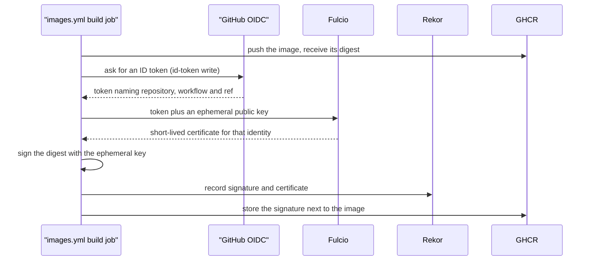
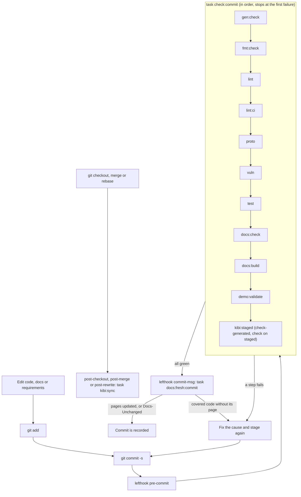
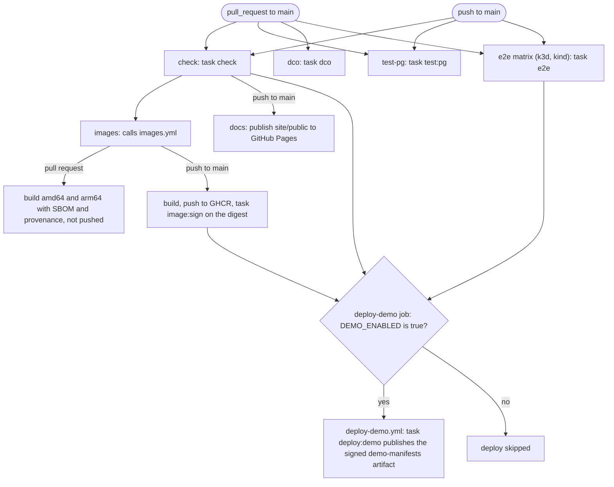
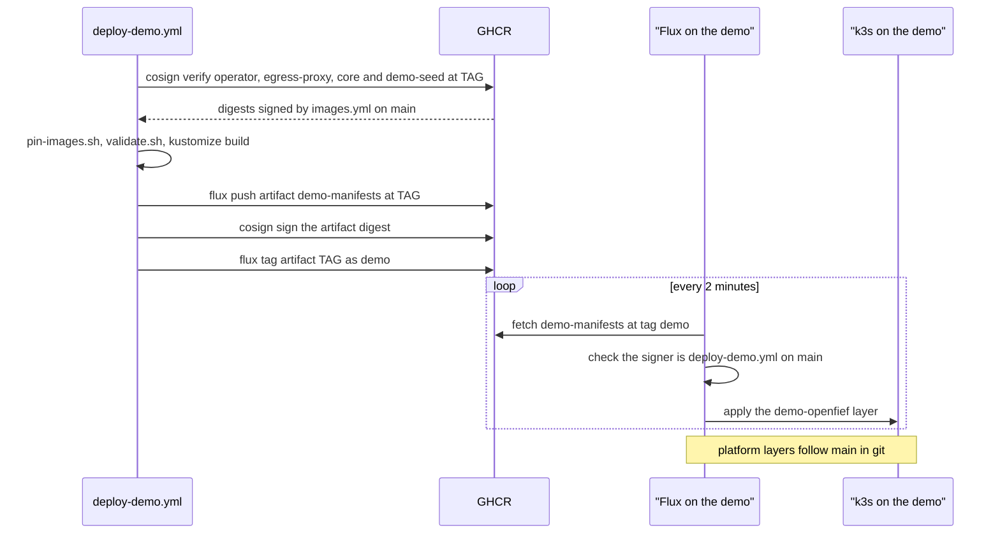
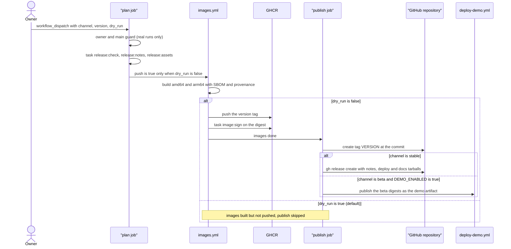

This page explains the machinery that takes a change from a commit on a branch to signed container images, a tagged release and the demo environment. It describes what the repository contains today, file by file. The rules this machinery enforces are in [sdlc.md](sdlc.md) and aren't repeated here. Where the two disagree, [Not built yet](#not-built-yet) says so.

## Concepts

**One entry point.** Make, written by Stuart Feldman at Bell Labs in 1976, gave a project one file that names every build step. [Task](https://taskfile.dev) follows the same idea, with YAML instead of Makefile syntax. In OpenFief, [Taskfile.yml](../../Taskfile.yml) is the only place a command is written down. A developer, a git hook and a CI job all run `task <target>`, so they can't drift into three slightly different scripts. The Taskfile also pins the version of every tool it calls.

**Shift-left checks.** "Shift left" (Larry Smith, 2001) means running a check earlier, when a failure is still cheap. In git, the earliest point is the pre-commit hook: the commit doesn't exist until its checks pass. [lefthook](https://github.com/evilmartians/lefthook) manages the hooks. It writes small scripts into `.git/hooks` that read [lefthook.yml](../../lefthook.yml).

**Conventional Commits.** A commit subject has the form `type(scope)!: summary`, as in `feat(ledger): add lots`. The convention grew out of the Angular project's commit guidelines. The type tells a machine what kind of change a commit is, and `!` or a `BREAKING CHANGE:` footer marks a breaking one. Here, the type decides which section of the release notes a commit goes in.

**CalVer and SemVer.** Semantic Versioning (`MAJOR.MINOR.PATCH`) is a compatibility promise: only a new major version may break you. That matters to code that depends on an API. Calendar Versioning puts the date in the number, as Ubuntu's `24.04` does, which tells a user how recent a release is. The product uses CalVer (`2026.11.0`). The protobuf contracts and SDKs are meant to use SemVer.

**DCO.** The [Developer Certificate of Origin](../glossary.md#other-terms-and-abbreviations) came from the Linux kernel in 2004, after the SCO lawsuits made the origin of code a legal question. Each commit carries a `Signed-off-by: Name <email>` trailer (`git commit -s`), by which the author certifies they may contribute it. It's lighter than a contributor licence agreement: there's nothing to sign beyond the commit itself. D-5 in [DESIGN.md](../DESIGN.md) requires it.

**Keyless signing.** [cosign](../glossary.md#other-terms-and-abbreviations) is the signing tool of Sigstore, a Linux Foundation project launched in 2021. Classic signing needs a long-lived private key that someone must guard and rotate. Keyless signing replaces the key with an identity. The CI job asks GitHub for an OIDC token that names the repository, workflow and ref. Sigstore's certificate authority, Fulcio, exchanges it for a certificate that is valid for about ten minutes. cosign signs with a throwaway key and records the signature in Rekor, a public append-only log. A verifier checks who signed (the workflow identity) rather than which key.



**Digest pinning.** An image tag such as `:main` is a movable pointer. A digest (`@sha256:...`) is the hash of the content, so it changes if one byte changes. Pinning a digest means you run exactly what was tested and signed. Here, GitHub Actions are pinned by commit SHA, Dockerfile base images by digest, and cosign signs the digest the build produced. D-17 requires plugin images to be pinned by digest.

**GitOps.** In a push deploy, CI holds a credential for the cluster and runs `kubectl apply`. GitOps, a name Weaveworks gave the practice in 2017, turns this around: an agent inside the cluster pulls the desired state from a versioned source and keeps the cluster matching it. [Flux](https://fluxcd.io), a CNCF project that grew out of Weaveworks, is such an agent. Nothing outside the cluster needs a way in, and the source's history is the deploy log. The demo's Flux pulls from git and from a signed OCI artifact: a registry entry that holds manifests instead of an image.

**Supply-chain hygiene with Renovate.** Exact pins stop surprise upgrades, but they go stale. [Renovate](https://docs.renovatebot.com) is a bot that finds pinned versions and opens pull requests to bump them, so each upgrade is a reviewed and tested change. It can't see a pin it can't parse, so the Taskfile and workflows mark versions with `# renovate:` comments.

**Traceability gate.** In safety-critical engineering, a traceability matrix links each requirement to the code that implements it and the test that verifies it. [kibi](kibi.md) keeps that record in `.kb/` and checks it with Prolog rules. Its gate in the pre-commit hook refuses a commit whose behavioral code has no owning requirement or no covering test.

## How it works

### The Taskfile

Every step is a task target, and `task --list` shows them with descriptions. Three conventions recur:

- **Pinned tools in `.bin/`.** The `vars` block pins golangci-lint, govulncheck, lefthook, Task itself, actionlint, controller-gen, Hugo, buf and its three generators (Go, Connect and the read API's OpenAPI), and for the demo hcloud, kustomize and gojq. The internal `tool:*` targets `go install` them into `.bin/`, and a `status` check skips the install unless the version changed. Go tools are built with the toolchain in `go.mod` (`GO_TOOLCHAIN`, now `go1.27.3`), because golangci-lint refuses code that targets a newer Go than it was built with. The envtest API server and etcd come from [envtest-assets.sh](../../scripts/envtest-assets.sh), which checks each archive against a pinned SHA-512. The flux CLI can't be built with `go install`, so `tool:flux` downloads its release archive and checks a pinned sha256. The k3s and Flux versions a demo machine installs are pinned here too, with their sha256 sums, and rendered into its cloud-init.
- **Explicit paths.** Tasks call `{{.BIN}}/golangci-lint`, not `golangci-lint`, so a global install can't shadow the pin.
- **Skip until it exists.** Many targets print "skipping" and succeed while their input is missing: `GO_GUARD` (no `go.mod`), `PROTO_GUARD` (no `.proto` files) and `e2e` (no `test/e2e`). The pipeline was built ahead of the product. Today only `e2e` still skips; since the connector contract and the read API landed in `proto/`, every proto step runs.

`task setup` runs once per clone. It installs the tools, runs `npm ci` for kibi, installs the lefthook hooks, and registers kibi's merge driver for the `.kb` files named in [.gitattributes](../../.gitattributes). CI runs `task setup:ci` instead, which skips lefthook and the merge driver and compiles the branch's knowledge base.

`check` (CI) and `check:commit` (the hook) run the same steps in the same order, with two differences: CI also runs the docs staleness gate over the pushed range (`docs:fresh`; the hook's version runs at `commit-msg`), and the kibi step at the end differs. Task runs a `cmds` list in sequence and stops at the first failure. "Each module" below means `GO_MODULES`: the core (`.`) and the Go SDK (`sdk/go`).

| Step | What it runs | Fails when |
|---|---|---|
| `gen:check` | `task gen` (controller-gen writes deepcopy code, [CRDs](../glossary.md#other-terms-and-abbreviations) and the operator's Role), then [gen-check.sh](../../scripts/gen-check.sh) | a regenerated file differs from the git index or is untracked |
| `fmt:check` | `golangci-lint fmt --diff` in each module (gofumpt with extra rules, goimports) | a file would be reformatted |
| `lint` | `golangci-lint config verify`, then `golangci-lint run` in each module | any finding; [.golangci.yml](../../.golangci.yml) enables every linter except a commented list |
| `lint:ci` | actionlint on the workflows, with its shellcheck and pyflakes integrations off | a workflow error |
| `proto` | `buf lint`, `buf format --diff`, [proto-breaking.sh](../../scripts/proto-breaking.sh) (with the base's own `buf.lock`), [proto-check.sh](../../scripts/proto-check.sh) | a lint or format issue, a breaking change against the base, or a stale `sdk/go/gen` or `gen/openapi` (the read API's OpenAPI document, generated from its protobuf and `read_service.openapi-base.yaml`) |
| `vuln` | [vulncheck.sh](../../scripts/vulncheck.sh): govulncheck in each module, then `npm audit --audit-level=high` | a finding, or an unreachable vulnerability database |
| `test` | `go test ./...` in each module with the envtest binaries, then the ten `scripts/tests/*.test.sh` | any failure |
| `docs:check` | [check-docs.sh](../../scripts/check-docs.sh) | an undefined or duplicate GR, D, P, T, OQ or R ID, or a changed ground-rule line |
| `docs:build` | [docgen](../../tools/docgen/main.go) writes the reference pages, then Hugo and [docs-diagrams.mjs](../../scripts/docs-diagrams.mjs) build the site ([docs.md](docs.md)) | a broken link, a diagram that doesn't render, or a docs page naming a kibi ID or task that doesn't exist |
| `docs:fresh` (CI only) | `git log` over the range from `DOCS_BASE`, piped into `docgen fresh` | covered code changed without a page covering it and without a `Docs-Unchanged:` trailer, or a Go package no page covers |
| `demo:validate` | [validate.sh](../../scripts/demo/validate.sh): `kustomize build` of `deploy/demo`, of every git path its Flux Kustomizations apply, and of `deploy/demo/openfief` | a layer doesn't build, an image isn't pinned by digest, an OCI source doesn't require a cosign signature, or a substituting layer uses a variable cloud-init doesn't define |
| `kibi:check` or `kibi:staged` | `kibi check` (CI); `kibi check-generated --staged --changed-only` and `kibi check --staged` (hook) | a knowledge-base rule violation |

Two steps compare against a base revision: the ground-rule check reads `DOCS_BASE`, and `proto:breaking` reads `PROTO_BASE`, then `DOCS_BASE`. Both default to `HEAD`, which locally means "against the last commit". CI sets `DOCS_BASE` to the pull request's base.

### Git hooks

[lefthook.yml](../../lefthook.yml) defines five hooks. Each calls one task with `.bin/` first on `PATH`, so the pinned Task runs:

- `pre-commit` runs `task check:commit`.
- `commit-msg` runs `task docs:fresh:commit` with the message file: the docs staleness gate on the staged files. It skips merge commits; CI checks the merged commits one by one.
- `post-checkout` runs `task kibi:sync` for a branch checkout (lefthook's `{3}` argument is `1`), not for a file checkout.
- `post-merge` runs `task kibi:sync`.
- `post-rewrite` runs `task kibi:sync` after a rebase, not after an amend.

kibi compiles one store per branch, and the sync hooks keep it in step with the branch you're on. kibi's own git hooks stay uninstalled, so lefthook alone owns `.git/hooks`.

The hook checks the working tree, not a clean copy of the index. Go tests, lint and the docs check read files on disk, so an unstaged edit can make a commit pass locally and fail in CI. Only `gen:check` and the kibi gate compare against the index.



### The kibi gate

On commit, `kibi:staged` runs two commands. `kibi check-generated --staged --changed-only` regenerates kibi's symbol manifest from the staged bytes and compares it with what is staged; it skips the work when no staged path can affect a symbol. `kibi check --staged` then runs kibi's rules on the staged change, including the rule that blocks a behavioral symbol with no `implements` requirement or no `covered_by` test. kibi's own help marks `--staged` as experimental.

In CI, the setup action sets `KIBI_BRANCH`, because `actions/checkout` leaves a detached HEAD and kibi won't write a store without a branch name. `setup:ci` then runs `kibi sync`, and `task check` ends with `kibi check` over the whole knowledge base. CI is therefore stricter than the hook: it also catches problems outside the staged change.

### CI on pull requests and main

[ci.yml](../../.github/workflows/ci.yml) runs on pull requests to `main` and on pushes to `main`. The workflow starts from `permissions: {}`, and each job asks only for what it needs. A newer push cancels a running pull-request run, but runs on `main` always finish, so every merge is built.

Each job first calls the composite [setup action](../../.github/actions/setup/action.yml). It installs Go from `go.mod`, installs Task at the Taskfile's `TASK_VERSION` and sets `KIBI_BRANCH`. Task is the one tool installed outside a task target, since no target can run before Task exists. By default the action also installs Node and runs `task setup:ci`; jobs that only need Task pass `tools: 'false'`.

- `check` runs `task check` with full history. `DOCS_BASE` is the pull request's base SHA, or the previous `main` (`github.event.before`) on a push.
- `test-pg` runs `task test:pg`. [test-pg.sh](../../scripts/test-pg.sh) starts a throwaway PostgreSQL from the runner's binaries on a Unix socket, each test creates a fresh database with every migration applied, and the server is removed afterwards. The same run loads the demo dataset end to end through `cmd/demo-seed`, and starts `cmd/core` on a fresh database to call its read API with a script token.
- `dco` runs on pull requests only: `task dco BASE=<base sha> HEAD=<head sha>`. [dco-check.sh](../../scripts/dco-check.sh) walks each non-merge commit in the range and requires a `Signed-off-by` trailer that matches the commit's author name and email exactly.
- `e2e` is a matrix over `k3d` and `kind` (D-12), and one failure doesn't cancel the other. A third-party action creates the cluster. `task e2e` then runs [assert-local-cluster.sh](../../scripts/assert-local-cluster.sh), which refuses any API server not on `127.0.0.1`, `localhost`, `0.0.0.0` or `[::1]`, and then runs `go test -tags e2e ./test/e2e/...`.
- `images` waits for `check` and calls [images.yml](../../.github/workflows/images.yml), with `push` true only on a push to `main`.
- `docs` runs on a push to `main` after `check`. `check` has built the site in `task check` and uploaded `site/public` as a Pages artifact; `docs` publishes it with GitHub's `deploy-pages` action to the `github-pages` environment ([docs.md](docs.md)). It needs the repository's Pages source set to "GitHub Actions", with the custom domain `openfief.dev`. With "Deploy from a branch", the deploy fails with a 404 and GitHub serves the repository root through Jekyll instead.
- `deploy-demo` runs on a push to `main` when the repository variable `DEMO_ENABLED` is `true`, after `check`, `e2e` and `images` succeed. It calls [deploy-demo.yml](../../.github/workflows/deploy-demo.yml), described in [The demo](#the-demo).



**Images.** The `discover` job runs `task ci:images`. It lists each `cmd/<name>/Dockerfile` and `plugins/<name>/Dockerfile` as a JSON matrix and lowercases the registry prefix; today that is `core`, `demo-seed`, `egress-proxy` and `operator`. An empty list skips `build` rather than failing it. `build` runs once per image. Buildx builds `linux/amd64` and `linux/arm64` from the repository root, attaches an SBOM and a full (`mode=max`) provenance attestation, and caches layers per image. The Dockerfiles copy `go.work`, `go.work.sum` and `sdk/go` and build in workspace mode, as the repository does locally, because the core imports the SDK module, which a private repository can't serve as a module version. They cross-compile Go on the build machine and copy the binary into a distroless base pinned by digest. When pushing, the job logs in to GHCR with the job's token, pushes, and runs `task image:sign IMAGE=<image>@<digest>`, so cosign signs the digest just pushed, never a tag. cosign v3 stores the signature as a Sigstore bundle attached to the digest as an OCI referrer. The operator verifies plugin images in that format and trusts `images.yml` on `main` as OpenFief's own signer, so signing has to stay in that workflow. The tags depend on the caller:

| Caller | Pushed and signed | Tags |
|---|---|---|
| Pull request | no, build only | none |
| Push to `main` | yes | `sha-<short sha>` and `main` |
| Release | yes, unless `dry_run` | the version, such as `2026.11.0-beta.1` |

### The demo

The demo is one Hetzner Cloud server running k3s, holding synthetic data only (GR-12). [demo.md](demo.md) is the operator's guide; it's a proposal, and this section only explains the machinery. The pipeline touches the demo in two ways.

**The machine.** `demo:plan`, `demo:up`, `demo:status`, `demo:down` and `demo:recreate` all run [demo.sh](../../scripts/demo/demo.sh) with the pinned hcloud CLI. They run from a terminal, or from [demo-infra.yml](../../.github/workflows/demo-infra.yml), a hand-started workflow in the GitHub Environment `demo`, which holds `HCLOUD_TOKEN` and `CLOUDFLARE_API_TOKEN`. The script keeps no state: it finds Hetzner resources by the labels `app=openfief` and `env=<name>`, and Cloudflare DNS records by the comment `managed-by=openfief-demo env=<name>`, so `up` creates only what is missing and `down` deletes only what is the demo's. With the Cloudflare token, `up` points `demo.openfief.dev` (an A and a CAA record) at the server, through curl and gojq; without it, `up` prints the record to create, and `DEMO_DOMAIN=none` falls back to an sslip.io name. `task dns:docs` (`demo.sh dns-docs`) keeps the docs site's CNAME the same way, under its own comment `managed-by=openfief-docs`. When the project has no SSH key labelled `openfief-ssh=true`, `up` installs a throwaway public key whose private half is never stored, so Hetzner sets no root password. Before it creates anything, it prices the server and its IPv4 from Hetzner's price list in integer micro-euros. It refuses if the monthly total of all OpenFief resources would exceed `DEMO_BUDGET_EUR`, which defaults to 10 EUR. `down` and `recreate` need `CONFIRM` set to the demo's name. The server boots from [cloud-init.yaml](../../deploy/demo/cloud-init.yaml), filled in with the Taskfile's pins. It installs k3s and Flux, checking each download's sha256, and points Flux at `deploy/demo` on `main`.

**Deploys.** Nothing outside the machine holds a credential for the cluster. Flux follows two kinds of source, declared in [stack.yaml](../../deploy/demo/stack.yaml). The platform layers follow `main` in git: the CRDs, the CloudNativePG operator and database, cert-manager and the Let's Encrypt issuer. OpenFief itself, today the operator, the egress proxy, the core and the `demo-seed` Job that loads the synthetic demo dataset ([demo.md](demo.md#demo-data)), follows a signed OCI artifact. [deploy-demo.yml](../../.github/workflows/deploy-demo.yml) publishes it by running `task deploy:demo TAG=<tag> REPO=<owner/repo>`, where the tag is `sha-<short commit>` for `main` or the version for a beta:

1. [pin-images.sh](../../scripts/demo/pin-images.sh) runs `cosign verify` on each image at that tag. It accepts only a signature from `images.yml` on `main`, and writes the verified digest over the all-zeros placeholder in `deploy/demo/openfief/kustomization.yaml`. One unverified image fails the deploy.
2. validate.sh checks the result, and kustomize renders it.
3. `flux push artifact` pushes the manifests to `ghcr.io/<owner>/<repo>/demo-manifests:<tag>`. cosign signs that digest keylessly, and `flux tag artifact` moves the `demo` tag to it.
4. Flux on the machine checks the `demo` tag every two minutes. It applies a new artifact only if the signature comes from `deploy-demo.yml` on `main`.

The deploy job runs in the `demo` environment with `packages: write` and `id-token: write` and no secret. A concurrency group makes deploys queue instead of overlapping.



### Releases

[release.yml](../../.github/workflows/release.yml) only starts by hand (`workflow_dispatch`) and takes three inputs: `channel` (`beta` or `stable`), `version`, and `dry_run`, which defaults to `true`. Only one release runs at a time.

1. `plan` refuses a real run unless the actor is the repository owner and the ref is `main`. It then runs three tasks on full history. `release:check` calls [release-version.sh](../../scripts/release-version.sh): stable must be `YYYY.M.N` and beta `YYYY.M.N-beta.K`, with no `v`, no leading zeros, a month from 1 to 12, `K` from 1 up, and no existing tag. `release:notes` writes the notes to the run's summary page. `release:assets` packs `deploy/` into `dist/openfief-deploy-<version>.tar.gz` and builds the docs site into `dist/openfief-docs-<version>.tar.gz`; these copies are only a trial and are discarded.
2. `images` calls images.yml with the version as the tag, and pushes and signs only on a real run.
3. `publish` runs only on a real run. `task release:publish` repeats the version check, rebuilds the tarball and notes, and creates the tag at the checked-out commit through the GitHub API. For `stable` it also creates a GitHub release with the notes and both tarballs. A beta gets a tag and no GitHub release.
4. `deploy-demo` runs after a real beta when `DEMO_ENABLED` is `true`. It publishes the beta's verified digests as the demo artifact, as above, with the version as the tag.

[release-notes.sh](../../scripts/release-notes.sh) finds the previous release with `git describe`, limited to tags that start with four digits. A stable release skips beta tags, so its notes cover the whole cycle; a beta starts after the newest release of either channel. Each non-merge commit goes into Breaking changes (`!` or a `BREAKING CHANGE:` footer), Features (`feat`), Fixes (`fix`), Performance (`perf`) or Other changes, which also takes anything not in Conventional Commit form.



### Pins and Renovate

[renovate.json](../../renovate.json) enables four managers: Go modules, npm, GitHub Actions, and a regex manager for `# renovate:` comments in Taskfile.yml and `.github/`. `rangeStrategy: pin` keeps versions exact, and `helpers:pinGitHubActionDigestsToSemver` pins each action to a commit SHA with the version as a comment. Updates are grouped into one PR each for Actions, kibi, Taskfile tools, CI toolchains and Go modules. Renovate commits as `build(deps): ...` with a `Signed-off-by` line, so its PRs pass the DCO check and land under Other changes in the release notes.

| What | Pinned in | Kept current by |
|---|---|---|
| Go toolchain | `toolchain go1.27.3` in both `go.mod` files; `golang:1.27.3` by digest in the Dockerfiles | Renovate for `go.mod`; nothing for the Dockerfiles |
| Go dev tools, including Hugo, hcloud, kustomize and gojq | Taskfile `vars` | Renovate, "Taskfile tools" |
| kibi, Mermaid, playwright-core | exact versions in [package.json](../../package.json), plus `package-lock.json` | Renovate (npm); kibi as one group |
| flux CLI; k3s and Flux on the demo machine | Taskfile `vars`, each with sha256 sums | Renovate bumps the version; the sums by hand ([demo.md](demo.md#update-the-pinned-versions)) |
| Demo Helm charts (CloudNativePG, cert-manager) | `deploy/demo/*/helmrelease.yaml` | nothing |
| Actions | a commit SHA in each `uses:` | Renovate, "GitHub Actions" |
| Node, k3d, kind | the setup action and ci.yml, with `# renovate:` comments | Renovate, "CI toolchains" |
| envtest binaries | `ENVTEST_K8S_VERSION` plus SHA-512 sums in envtest-assets.sh | by hand |
| Protobuf dependencies (googleapis, for the read API's HTTP rules) | `buf.lock`, by commit and digest; buf fetches them from the Buf Schema Registry | by hand (no Renovate manager for buf) |
| Sigstore trust root the operator verifies against | `internal/plugins/cosign/trusted_root.json` | `task trustroot:update`, by hand: it fetches the root through TUF, and the diff is reviewed |
| Base images | digests in `cmd/*/Dockerfile` | nothing (see below) |
| kubectl, gh, Buildx, QEMU, Chrome (docs diagrams), PostgreSQL (`test:pg`) | the runner image and the actions' defaults | not pinned here |

## Verification

The pipeline's decisions live in shell scripts, and each script that decides something non-trivial has a test in [scripts/tests](../../scripts/tests). Each test works in a throwaway directory or git repository from `mktemp`. The git tests also clear `GIT_DIR` and its siblings, which a hook exports, so they can't touch the real repository. Each test is a kibi test record that covers a tooling requirement. `task test` runs all ten, so they run in the hook and in CI.

| Test | Proves |
|---|---|
| `check-docs.test.sh` (TEST-tooling-docs-check) | Unchanged docs pass; a reference to an undefined ID, an edited ground-rule line, an ID defined twice and a base revision that isn't a commit each fail with the right message. |
| `vulncheck.test.sh` (TEST-tooling-vuln-offline) | A high npm finding fails, an unreachable npm registry fails, and a govulncheck that can't reach `vuln.go.dev` fails. Stubs keep it offline. |
| `ci-images.test.sh` (TEST-tooling-ci-images) | No Dockerfile gives `[]`; two Dockerfiles give the expected matrix with a lowercased prefix; a duplicate or invalid image name fails. |
| `dco-check.test.sh` (TEST-tooling-dco) | A commit signed off by its author passes; a sign-off by someone else and a missing sign-off both fail and name the commit. |
| `release-version.test.sh` (TEST-tooling-release-version) | 14 table cases: valid stable and beta versions pass; a `v` prefix, leading zeros, month 13, `beta.0`, the wrong or an unknown channel, and an existing tag fail. |
| `release-notes.test.sh` (TEST-tooling-release-notes) | Stable notes start after the previous stable, beta notes after the previous release of either channel, a first release covers all history, and both `!` and `BREAKING CHANGE:` count as breaking. |
| `proto-breaking.test.sh` (TEST-tooling-proto-breaking) | A base without contracts passes; adding a field passes; changing a field's type fails and names it; `PROTO_BASE` and `DOCS_BASE` both select the base. Needs `buf` on `PATH`. |
| `demo.test.sh` (TEST-tooling-demo) | 173 checks against a fake hcloud with synthetic prices, and a fake curl that plays the Cloudflare DNS API on a record file. DNS records are created, updated in place on a new IPv4, left alone on a second run, and deleted only when they carry the demo's comment; a record set by hand at the demo's name is refused; without a Cloudflare token the demo falls back to sslip.io. Without a labelled SSH key, only a throwaway Ed25519 public key is uploaded, and `down` deletes it. `demo.sh dns-docs` creates and updates only its own CNAME, refuses a foreign record at `docs.<domain>`, and never touches the demo's records. A missing token is refused before any API call. `plan` prices the server and IPv4 and creates nothing. `up` over budget is refused, counting existing resources; otherwise it creates the firewall before the server, with labels, keys and rules, and a second `up` creates nothing. `down` needs the matching `CONFIRM`. The rendered cloud-init pins k3s for the CPU, leaves no placeholder and holds no token. |
| `demo-pin-images.test.sh` (TEST-tooling-demo-pin-images) | With a fake cosign: signed images get their digests and comments survive; only `images.yml` on `main` is trusted; an unsigned image fails and keeps its placeholder; a malformed tag or digest is refused. |
| `demo-validate.test.sh` (TEST-tooling-demo-validate) | The committed manifests pass; an OCI source without cosign verification, an image pinned by tag only, a Flux path that doesn't build and an undefined substitution variable each fail. |

To run them and the other self-checks:

```sh
task test                      # Go tests plus the ten script tests
bash scripts/tests/dco-check.test.sh
PATH="$PWD/.bin:$PATH" bash scripts/tests/demo.test.sh
task lint:ci                   # actionlint over the workflows
task gen:check                 # regenerate, then fail on drift
task proto                     # buf lint, breaking and generated-code checks
task demo:validate             # build every demo layer offline; digests and signatures
task demo:plan ENV=demo        # read-only Hetzner (and Cloudflare) API calls; needs HCLOUD_TOKEN
task ci:images PREFIX=ghcr.io/arkadiuss/openfief
task release:check CHANNEL=beta VERSION=2026.11.0-beta.1
task release:notes VERSION=2026.11.0
task dco BASE=origin/main HEAD=HEAD
```

actionlint checks the workflows only statically. To exercise the release workflow without publishing, dispatch a dry run with `gh workflow run release.yml -f channel=beta -f version=2026.11.0-beta.1 -f dry_run=true`, and read the notes on the run's summary page. To check what was published, verify the signatures with the identities the pipeline itself trusts, and read an image's SBOM:

```sh
cosign verify ghcr.io/arkadiuss/openfief/operator:main \
  --certificate-oidc-issuer https://token.actions.githubusercontent.com \
  --certificate-identity https://github.com/arkadiuss/openfief/.github/workflows/images.yml@refs/heads/main
cosign verify ghcr.io/arkadiuss/openfief/demo-manifests:demo \
  --certificate-oidc-issuer https://token.actions.githubusercontent.com \
  --certificate-identity https://github.com/arkadiuss/openfief/.github/workflows/deploy-demo.yml@refs/heads/main
docker buildx imagetools inspect ghcr.io/arkadiuss/openfief/operator:main --format '{{ json .SBOM }}'
```

pin-images.sh trusts the first identity and Flux the second. Both assume that Fulcio names the reusable workflow that ran the job, not the workflow that called it; this page hasn't been checked against a real certificate. On the machine, `flux get sources oci` and `flux get kustomizations` show what Flux verified and applied ([demo.md](demo.md#reach-the-demo)).

Nothing tests [assert-local-cluster.sh](../../scripts/assert-local-cluster.sh), gen-check.sh, proto-check.sh, envtest-assets.sh or test-pg.sh, a demo machine's boot, or the tasks only CI runs: `image:sign`, `deploy:demo` as a whole and `release:publish`.

## Not built yet

These are the gaps between [sdlc.md](sdlc.md) or [testing.md](testing.md) and the files, plus things that look broken.

- **Local green isn't always CI green** (sdlc.md:10). The hook ends with `kibi:staged`, while CI checks the whole knowledge base (the last steps of `check:commit` and `check` in Taskfile.yml). DCO and the PostgreSQL tests run only in CI; the `commit-msg` hook runs only the docs gate. The hook reads the working tree, so unstaged edits count. Vulnerability databases change between runs.
- **A failing PostgreSQL test doesn't stop the demo deploy.** `deploy-demo` needs `check`, `e2e` and `images`, but not `test-pg` (ci.yml:161).
- **Not everything goes through a task target** (sdlc.md:17). Docker's actions build and push images inside images.yml, so no task target builds an image locally. Third-party actions also create the e2e clusters and publish the docs site.
- **Not every tool is pinned in the Taskfile** (sdlc.md:18). Node, k3d and kind are pinned in the workflows, and the demo's Helm charts in `deploy/demo`. kubectl, gh, Buildx, QEMU, the Chrome that renders docs diagrams and the PostgreSQL that `test:pg` starts come from the runner image or the actions' defaults.
- **`task vuln` ignores low and moderate npm findings** (sdlc.md:19 says any finding). vulncheck.sh:24 passes `--audit-level=high`, and the test covers only a high finding.
- **Conventional Commits aren't enforced** (sdlc.md:25). Nothing lints commit messages or PR titles, and a non-conforming commit lands under Other changes.
- **No PR template** asks which requirements a PR implements or how it was verified (sdlc.md:26).
- **End-to-end tests don't exist** (sdlc.md:11 and :31). `test/e2e` is missing, so both e2e jobs create a cluster, pass the local-cluster guard and skip (the `e2e` target). Nothing builds or loads images, or installs `deploy/`, into the cluster yet. The guard has no test, though REQ-tooling-e2e-local-only has a scenario.
- **The demo serves no product yet** (sdlc.md:12 and :32). The deploy path is built, but whether it runs depends on settings outside the repository: the `demo` environment, public GHCR packages and `DEMO_ENABLED`. The app layer holds the operator and the egress proxy, and `demo-routes` stays suspended until a core service exists (deploy/demo/stack.yaml:107). The demo database stays empty too: deploy/demo-data/kustomization.yaml:2 says `deploy/demo` includes the seed Job, but nothing under `deploy/demo` refers to it, and `deploy/demo/openfief` doesn't pin the `demo-seed` image.
- **Releases don't pin their images** (sdlc.md:41, D-17). images.yml exposes no digest output. The stable tarball ships `deploy/` with bases that name images without a tag or digest (deploy/operator/deployment.yaml:28, deploy/egress-proxy/deployment.yaml:26) and expect an overlay to pin them. Only the demo has such an overlay, and CI fills it in at deploy time. "The CRDs and the bootstrap install" are one archive of `deploy/`.
- **The dry run is per run, not a gate** (sdlc.md:42). A run with `dry_run: false` validates in `plan`, then pushes and signs images straight away (release.yml:73-83). Nothing requires an earlier dry run of the same commit, or checks that the commit passed CI. Because image builds don't fail fast, one image can be pushed while another fails, which leaves pushed images with no tag.
- **No SDK or contract releases** (sdlc.md:43). There's no `sdk/go/vX.Y.Z` tagging and no TypeScript SDK. `buf breaking` now has contracts to check (the connector contract and the read API) and runs on every change, not only before an SDK release.
- **Renovate misses some pins** (sdlc.md:47). `enabledManagers` (renovate.json:5) lacks `dockerfile`, yet cmd/operator/Dockerfile:3, cmd/egress-proxy/Dockerfile:3 and cmd/demo-seed/Dockerfile:5 say Renovate updates them, so `golang:1.27.3` can drift from `go.mod`'s toolchain. No manager reads the demo's Helm chart versions. For k3s and Flux, Renovate bumps the version but not the sha256 sums beside it: a stale flux CLI sum fails the next deploy job, while stale k3s or Flux install sums show up only when a machine boots and stops at that download.
- **Smaller issues.** `task test` runs proto-breaking.test.sh, but its `deps` install envtest, kustomize and gojq, not `buf`, so it fails on a clone whose `.bin/` predates buf; `task check` hides this because `proto` runs first. The setup action's "no go.mod yet" step is dead now that `go.mod` exists (action.yml:22-28). cmd/demo-seed/Dockerfile:3-4 still says that go.mod alone builds the image, though every Dockerfile now builds the Go workspace with `sdk/go`. `proto:gen`'s description says "no remote BSR", which holds for the plugins, but buf now fetches googleapis from the Buf Schema Registry, so the proto steps need the network until buf has cached it.
