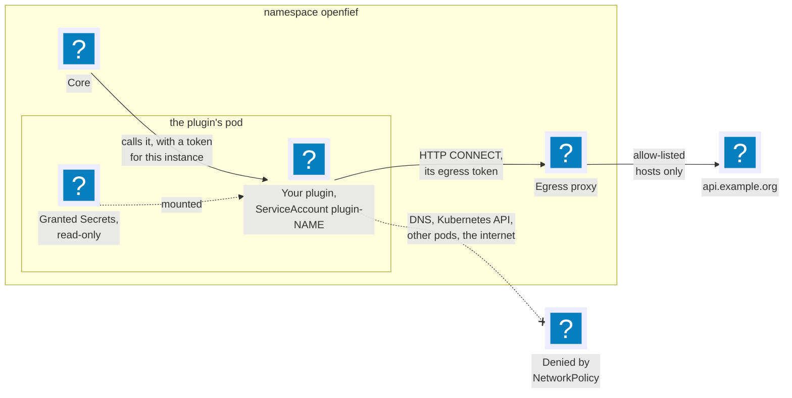
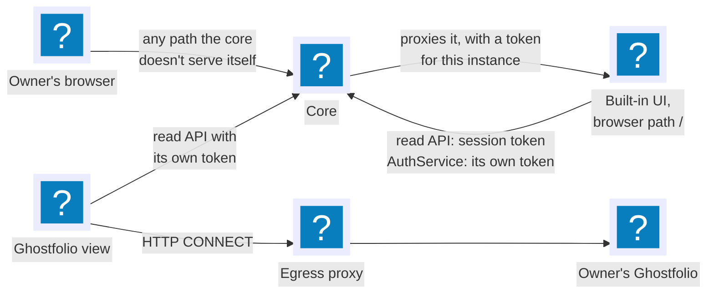

This guide is for a Go developer who wants to write a [connector](../glossary.md) or a [view](../glossary.md). It follows one real plugin, [nbp-fx](../../plugins/nbp-fx/), from its source files to a running pod, and shows the commands at each step. It explains what you do and links to the concept pages for why the platform works that way: [Plugins](../concepts/plugins.md), [Operator](../concepts/operator.md) and [Egress](../concepts/egress.md).

## What a plugin is

Everything outside OpenFief's core is a [plugin](../glossary.md): a container image that runs in its own pod, and an installed, named instance of it. What a plugin may act as is its [capability](../glossary.md):

- A **connector** brings data in. The core calls it over the [connector contract](../glossary.md) to sync, or to import a file or bond lots, and it answers with a [delivery](../glossary.md).
- A **view** shows the record somewhere else. It reads the [read API](../glossary.md) and never writes back.
- Agents come in a later milestone.

The image declares what it needs in its [manifest](../glossary.md), and the [owner](../glossary.md) approves it in a [grant](../glossary.md). Only what both hold is enforced (D-16). From that, the operator gives each instance:

- its own pod, and its own ServiceAccount `plugin-<name>`, its [plugin identity](../glossary.md), with no Kubernetes API token;
- the Secrets the grant names, mounted read-only, and nothing else;
- a network that reaches only the core and, if the grant holds any [egress hosts](../glossary.md), the [egress proxy](../glossary.md), which lets it through to those hosts alone. There is no DNS (D-32).



The operator passes the rest through the environment, and the Go SDK, package [`openfief`](../../sdk/go/openfief/), reads it for you:

| The operator sets | The SDK reads it in |
|---|---|
| `OPENFIEF_LISTEN_PORT`, the port to serve on | `ListenAddress`, `ServeConnector` |
| `OPENFIEF_CONFIG`, the instance's config as JSON | `LoadConfig` |
| `OPENFIEF_CORE_ADDRESS`, the core's ClusterIP and port | `CoreURL` |
| `OPENFIEF_TOKEN_FILE`, the token for the core | `TokenFile`, which you hand to `CoreHTTPClient` |
| `OPENFIEF_INSTANCE`, `OPENFIEF_CORE_SUBJECT`, `OPENFIEF_SA_JWKS_DIR` | `NewCoreVerifier`, which checks the core's calls (D-59) |
| `HTTPS_PROXY`, `OPENFIEF_EGRESS_TOKEN_FILE`, only with egress hosts | `NewEgressClient` (D-63) |

The pod also runs as a non-root user with a read-only root filesystem and no writable volume, so keep what you work on in memory.

## The lifecycle

```mermaid
flowchart TB
  subgraph dev["You, the developer"]
    direction LR
    code@{ icon: "fief:script", form: "square", label: "main.go and<br/>manifest.json", pos: "b", h: 40 }
    img@{ icon: "fief:image", form: "square", label: "Image with the<br/>manifest label", pos: "b", h: 40 }
    seal@{ icon: "fief:seal", form: "square", label: "Signature<br/>on its digest", pos: "b", h: 40 }
    code -- "task plugins:labels,<br/>docker build, push" --> img
    img -- "cosign sign" --> seal
  end
  subgraph cluster["The owner's cluster"]
    direction LR
    owner@{ icon: "fief:owner", form: "square", label: "The owner runs<br/>openfief plugin install", pos: "b", h: 40 }
    op@{ icon: "fief:operator", form: "square", label: "Operator verifies<br/>and deploys", pos: "b", h: 40 }
    plugin@{ icon: "fief:connector", form: "square", label: "Plugin pod", pos: "b", h: 40 }
    egress@{ icon: "fief:egress", form: "square", label: "Egress proxy", pos: "b", h: 40 }
    core@{ icon: "fief:gate", form: "square", label: "Core", pos: "b", h: 40 }
    owner -- "Plugin and<br/>PluginGrant" --> op
    op --> plugin
    core -- "calls it with a<br/>short-lived token" --> plugin
    plugin -- "allow-listed<br/>hosts only" --> egress
  end
  dev -- "image@sha256:..." --> cluster
```



1. You write the code and `manifest.json`.
2. `task plugins:labels` copies the manifest into the Dockerfile as the image label `io.openfief.plugin.manifest` (D-42). You build the image and push it.
3. You sign the pushed digest with [cosign](../glossary.md).
4. The owner runs `openfief plugin install` with the image's digest. The CLI checks the signature, shows what the manifest requests and, once the owner confirms, creates a `Plugin` and a `PluginGrant` that approves exactly that (D-46).
5. The operator checks the digest's signature again, offline, and that the signed label equals the `Plugin`'s manifest (D-56). Only then does it deploy.
6. The core calls the plugin with a 10-minute token whose audience is that instance (D-59).
7. The plugin reaches its allow-listed hosts through the egress proxy.

## Write a connector: nbp-fx

nbp-fx is the simplest connector there is. Each sync, it fetches the National Bank of Poland's table A exchange rates for the days since the last one and hands them to the core. It has four source files: [manifest.json](../../plugins/nbp-fx/manifest.json), [main.go](../../plugins/nbp-fx/main.go), [connector.go](../../plugins/nbp-fx/connector.go) and a [Dockerfile](../../plugins/nbp-fx/Dockerfile). The NBP client itself is in [internal/valuation/nbp](../../internal/valuation/nbp/client.go); the plugin only wires it to the SDK.

A plugin of your own should import only the SDK module, [sdk/go](../../sdk/go/), which is Apache-2.0 (D-5). nbp-fx also uses the core's `internal/` packages, which only code in this repository can import. The SDK isn't published as a Go module version yet, so for now a plugin builds inside this repository's Go workspace, as the first-party ones do.

### The manifest

```json
{
  "capabilities": ["connector"],
  "egress": ["api.nbp.pl"],
  "configSchema": {
    "type": "object",
    "properties": {
      "start": {"type": "string", "minLength": 10, "maxLength": 10, "pattern": "^[0-9]{4}-[0-9]{2}-[0-9]{2}"}
    },
    "additionalProperties": false
  }
}
```

- `capabilities`: it acts as a connector, nothing else.
- `egress`: it may reach `api.nbp.pl` on port 443, the default. NBP's API is public, so it needs no Secret.
- `configSchema`: an instance takes one optional key, `start`, the first day of the first sync. The CLI and the operator both check the owner's config against it.

Ask for as little as you can. Every entry is something the owner has to approve, and the [Manifest reference](#manifest-reference) below lists every field.

### The entry point

[main.go](../../plugins/nbp-fx/main.go) reads its config, builds an HTTP client that goes through the egress proxy, and serves:

```go
// run serves the connector until ctx is done.
func run(ctx context.Context, log *slog.Logger) error {
	var cfg config
	if err := openfief.LoadConfig(&cfg); err != nil {
		return fmt.Errorf("config: %w", err)
	}
	start, err := cfg.startDate(today())
	if err != nil {
		return err
	}
	hc, err := openfief.NewEgressClient()
	if err != nil {
		return fmt.Errorf("egress: %w", err)
	}
	hc.Timeout = requestTimeout
	log.Info("nbp-fx serving", "first_sync_from", start.String())
	if err := openfief.ServeConnector(ctx, newConnector(hc, start)); err != nil {
		return fmt.Errorf("nbp-fx: %w", err)
	}
	return nil
}
```

`ServeConnector` is the whole serving side ([run.go](../../sdk/go/openfief/run.go)). It listens on `OPENFIEF_LISTEN_PORT`, answers `401` to any call that doesn't carry the core's token for this instance, and when the context ends, stops taking calls and lets those in flight finish for up to 20 seconds. `main` cancels that context on `SIGTERM`, which Kubernetes sends before it stops a pod.

### The contract

The core calls `openfief.connector.v1.ConnectorService`, defined in [connector.proto](../../proto/openfief/connector/v1/connector.proto) (D-49). Its three methods are `Sync`, `ImportFile` and `ImportBondLots`. nbp-fx embeds the generated `UnimplementedConnectorServiceHandler`, so the two it doesn't serve answer `UNIMPLEMENTED`, and writes only `Sync` ([connector.go](../../plugins/nbp-fx/connector.go)):

```go
type connector struct {
	connectorv1connect.UnimplementedConnectorServiceHandler

	rates app.RateProvider
	today func() kernel.Date
	start kernel.Date
}

func (c *connector) Sync(ctx context.Context, req *connect.Request[connectorv1.SyncRequest]) (*connect.Response[connectorv1.SyncResponse], error) {
	from, err := c.from(req.Msg.GetWatermark())
	if err != nil {
		return nil, status(connect.CodeInvalidArgument, err)
	}
	watermark := req.Msg.GetWatermark()
	out := &connectorv1.Delivery{BatchId: req.Msg.GetBatchId(), Institution: institution}
	if to := c.today(); !from.After(to) {
		rates, err := app.FetchRates(ctx, c.rates, from, to, nbp.MaxRangeDays)
		if err != nil {
			return nil, status(connect.CodeUnavailable, fmt.Errorf("nbp-fx: %w", err))
		}
		out.FxRates = delivery.FXRates(rates)
		if len(rates) > 0 {
			watermark = rates[len(rates)-1].Date.String() // FetchRates sorts by date
		}
	}
	return connect.NewResponse(&connectorv1.SyncResponse{Delivery: out, Watermark: watermark}), nil
}
```

The rules every connector follows:

- **Echo the batch ID.** The core makes one per [import batch](../glossary.md) and refuses a delivery whose `batch_id` differs. A failed batch is retried with the same ID, so delivering it twice must do no harm.
- **Return a [watermark](../glossary.md).** It is yours and opaque to the core, which stores it once the delivery is imported and sends it back on the next `Sync`. An empty one means a first sync. nbp-fx stores the date of the latest rates, and keeps the old watermark when NBP published nothing new.
- **Pick the error code.** `UNAVAILABLE` when the [institution](../glossary.md) fails, so the core retries the batch later; `INVALID_ARGUMENT` for input you can't read, such as a watermark you never wrote. For `ImportFile`, the reason you give with `INVALID_ARGUMENT` is what the owner sees.
- **Keep money exact.** Amounts, prices, rates and quantities are decimal strings, dates are `YYYY-MM-DD`, currencies ISO 4217 codes; the file's header lists every convention. An `account_id` is OpenFief's own ID, never the institution's account number.

A connector that delivers transactions writes only into accounts the owner bound it to, with a [connector binding](../glossary.md) ([Ingest](../concepts/ingest.md#connector-bindings)). nbp-fx delivers only FX rates, so it needs none. A connector that takes files reads the `ImportFile` stream with `openfief.ReceiveFile(stream, limit)`, as [ibkr-flex](../../plugins/ibkr-flex/connector.go) does.

### Reaching the institution

`newConnector` hands the egress client to the NBP adapter, which calls `https://api.nbp.pl`:

```go
func newConnector(hc *http.Client, start kernel.Date) *connector {
	return &connector{rates: nbp.New(hc, nbp.DefaultBaseURL), today: today, start: start}
}
```

For every request, the client's `EgressTransport` reads the egress token file again and puts the token in the proxy URL as its password, which Go sends on the [HTTP CONNECT](../glossary.md) that opens a tunnel through the proxy. TLS runs end to end inside the tunnel ([egress.go](../../sdk/go/openfief/egress.go)). The proxy resolves the name and lets the tunnel through only to a host on this instance's [egress allow-list](../glossary.md), which holds exactly the hosts both manifest and grant name. The client refuses plain `http` (`ErrNotHTTPS`). Without a granted egress host, `HTTPS_PROXY` isn't set and `NewEgressClient` fails with `ErrNoEgressProxy`, so a plugin that reaches nothing outside shouldn't call it. [Egress](../concepts/egress.md) explains the checks on the proxy's side.

## Manifest reference

The label holds one JSON object. [ParseManifestLabel](../../internal/plugins/manifest_label.go) reads it, refuses unknown fields, and validates it with `Manifest.Validate` in [manifest.go](../../internal/plugins/manifest.go). The `Plugin` resource's `spec.manifest` has the same fields and must equal the label.

| Field | Meaning | Example |
|---|---|---|
| `capabilities` | Required, at least one: `connector` or `view`, no repeats. | `["connector"]` |
| `egress` | Egress hosts, `host` or `host:port`; the port defaults to 443. Canonical lower-case hostnames of at least two labels: no IP address, no wildcard, no single-label name. | `["api.nbp.pl"]` |
| `secrets` | Secrets by role, each a `role` (a DNS label) and a `mountPath`, mounted read-only. Each instance mounts the Secret `<instance>-<role>` in the `openfief` namespace (D-89). The path is absolute and clean, isn't `/`, doesn't overlap another, and stays out of `/var/run/secrets`. The owner creates the Secrets (D-29). | `[{"role": "flex-token", "mountPath": "/etc/openfief/ibkr-flex"}]` |
| `egressFromConfig` | Top-level config fields whose value, an `https` URL, gives a host the plugin reaches through the egress proxy instead of a fixed one (D-75). The install shows the host and the grant approves exactly it; an IP address, a wildcard or plain `http` is refused, and an absent or empty field asks for nothing. | `["url"]` |
| `clusterService` | Asks for one service in the same cluster that the owner picks at install, with a `description` the CLI shows when it asks (D-74). The plugin reaches it directly, outside the proxy, at the address in `OPENFIEF_CLUSTER_SERVICE_ADDRESS` (`ClusterIP:port`), possibly over plain HTTP. | `{"description": "a Ghostfolio running in this cluster"}` |
| `dataTiers` | Names of classes of data, 1 to 32 letters, digits, `-` or `_`. Only names today: nothing enforces them (P-33). | No first-party plugin declares one |
| `configSchema` | A JSON Schema for the instance's config. Its `$ref` may reach only the schema itself and the standard meta-schemas, never a file or URL. Without one, any config is accepted. | nbp-fx's schema above |
| `browserPath` | For a view that serves browsers: the path prefix the core proxies to it (D-81). See [View plugins](#view-plugins). | `"/"` |
| `crossCheckPrices` | A connector that sends [cross-check prices](../glossary.md) in its deliveries declares it; the core stores none from one that doesn't (D-112). | `true` (ibkr-flex) |
| `statementFiles` | A connector that takes statement files the owner uploads declares it; the UI offers the upload form only on accounts bound to one (D-109). | `true` (ibkr-flex) |

Because the manifest names a role and each instance mounts `<instance>-<role>`, two instances of one image, such as one per IBKR account, never share a Secret: `ibkr-joint` mounts `ibkr-joint-flex-token`.

## Test it

nbp-fx has two test files, and they show the three levels worth testing.

**The handler, as a table test.** `TestSync` in [connector_test.go](../../plugins/nbp-fx/connector_test.go) builds the `connector` with a fake `RateProvider` that publishes synthetic rates on chosen days, and a fixed `today`. Each case gives a watermark and checks the date range asked for, the rates delivered, the next watermark and the error code: a first sync, a sync after the watermark, nothing new, already up to date, a watermark it never wrote (`InvalidArgument`) and NBP failing (`Unavailable`).

**The served connector, called as the core calls it.** `TestServedConnector` serves the same handler with the SDK, behind a `fakeVerifier` whose `VerifyCore` accepts one synthetic token and returns `openfief.ErrNotCore` for any other:

```go
	server := openfief.NewConnectorServer("", c, fakeVerifier{})
	srv := httptest.NewUnstartedServer(server.Handler)
	srv.Config.Protocols = server.Protocols
	srv.Start()
```

It then calls the server with the generated `connectorv1connect` client: `Sync` with the token answers, `Sync` without it is `Unauthenticated`, and `ImportFile` is `Unimplemented`. `NewConnectorServer` is the same server `ServeConnector` runs, so this tests what runs in the pod, with no cluster.

**The manifest.** `TestManifest` in [main_test.go](../../plugins/nbp-fx/main_test.go) parses `manifest.json` with `plugins.ParseManifestLabel` and checks that it asks for exactly the connector capability and `api.nbp.pl`. A plugin outside this repository can't import that package, but the check is worth copying: the manifest is what the owner approves.

The HTTP adapter has tests of its own. [client_test.go](../../internal/valuation/nbp/client_test.go) replays [hypert](https://github.com/areknoster/hypert) recordings of the public `api.nbp.pl` from `testdata/`, offline, and checks every request against its recording. Recording is a deliberate, manual act: follow the [hypert-recording skill](../../.claude/skills/hypert-recording/SKILL.md) and [Testing](../dev/testing.md). Never record against an account with real data.

`task test` runs all of these with the rest of the repository; while you iterate, `go test ./plugins/nbp-fx/` runs only the plugin's. The end-to-end suite, `task e2e` on kind or k3d, deploys nbp-fx through the operator from a local registry, signed with a key made for the run ([plugins_test.go](../../test/e2e/plugins_test.go)).

## Build, label, sign and publish

### Label and build

The image's final stage carries the manifest as its label, so the signature over the image covers what it asks for (D-42). In nbp-fx's [Dockerfile](../../plugins/nbp-fx/Dockerfile):

```dockerfile
FROM gcr.io/distroless/static-debian12:nonroot@sha256:afa5c872c891853ca7fcf1f12c3edb23f7eeef36189728842dd51042ff57f7ab
# The plugin's manifest (D-42), signed with the image: written from manifest.json by `task plugins:labels`.
LABEL io.openfief.plugin.manifest='{"capabilities":["connector"],"configSchema":{"additionalProperties":false,"properties":{"start":{"maxLength":10,"minLength":10,"pattern":"^[0-9]{4}-[0-9]{2}-[0-9]{2}","type":"string"}},"type":"object"},"egress":["api.nbp.pl"]}'
COPY --from=build /out/plugin /plugin
```

The stage then sets `USER 65532:65532`. The user must be numeric: the pod runs with `runAsNonRoot`, and the kubelet refuses to start an image whose user is a name, since it can't tell that the name isn't root. Never edit the label by hand. For a plugin under `plugins/<name>/`, `task plugins:labels` writes `manifest.json`, compacted, into the Dockerfile's existing `LABEL io.openfief.plugin.manifest=` line ([plugin-labels.sh](../../scripts/plugin-labels.sh)). Copy nbp-fx's Dockerfile to start, since the task fails on a Dockerfile without that line. `task check` runs `task plugins:labels:check`, which fails when a label and its manifest differ.

Build from the repository root, which the Dockerfile copies the Go workspace from, and push:

```sh
task plugins:labels
docker build --file plugins/nbp-fx/Dockerfile --tag registry.example.org/you/nbp-fx:dev .
docker push registry.example.org/you/nbp-fx:dev
docker inspect --format '{{index .RepoDigests 0}}' registry.example.org/you/nbp-fx:dev
```

The last command prints the [image reference](../glossary.md) everything after this uses, `registry.example.org/you/nbp-fx@sha256:…`. A tag can be moved to another image by anyone who can push; a digest is the hash of the image, so it names exactly one, and it is what a signature covers (D-17). The operator and the CLI read the registry anonymously, so the image must be public.

A first-party plugin needs none of this by hand. CI builds every `plugins/<name>/Dockerfile` for `linux/amd64` and `linux/arm64`, pushes it to `ghcr.io/<owner>/<repo>/<name>` and signs it ([Pipeline](../dev/pipeline.md)).

### Sign

The operator deploys an image only when a [trusted signer](../glossary.md) signed its digest, and nothing overrides that (D-57). It trusts OpenFief's CI, publishers in the [catalog](../glossary.md), and signers the owner adds (D-45). Your plugin's signer is the third kind. It reads cosign v3's format: a Sigstore bundle stored next to the image as an OCI referrer.

**Keyless, from CI.** With keyless signing, cosign proves an identity such as a GitHub Actions workflow through OpenID Connect, gets a certificate for it that lasts minutes, and records the signature in Sigstore's public transparency log, so there is no key to guard ([Plugins](../concepts/plugins.md#concepts)). In a workflow allowed to request an OIDC token, sign the digest you just pushed, as OpenFief's `task image:sign` does:

```sh
cosign sign --yes registry.example.org/you/nbp-fx@sha256:…
```

**With a key, for local testing.** D-57 expects a developer to test with their own key:

```sh
cosign generate-key-pair
cosign sign --key cosign.key registry.example.org/you/nbp-fx@sha256:…
```

The operator doesn't need a transparency-log entry for a key signature. Either way, always sign the digest, never a tag.

## Install it on a cluster

There is no released `openfief` CLI yet, so build it from the repository with `go build ./cmd/openfief`.

### Trust your signer

The owner lists their signers in `signers.json`, in the optional ConfigMap `openfief-trusted-signers` ([deploy/operator](../../deploy/operator/kustomization.yaml)). A keyless signer is an issuer plus an exact `subject`, or a `subjectPattern` that must match the whole subject; a key signer is its public key in PEM:

```json
{"signers": [
  {"name": "my-ci", "issuer": "https://token.actions.githubusercontent.com",
   "subject": "https://github.com/example/nbp-fx/.github/workflows/release.yml@refs/heads/main"},
  {"name": "laptop", "publicKey": "-----BEGIN PUBLIC KEY-----\n...\n-----END PUBLIC KEY-----\n"}
]}
```

```sh
kubectl -n openfief create configmap openfief-trusted-signers --from-file=signers.json
kubectl -n openfief rollout restart deployment/openfief-operator
```

The operator reads the file only at start, and refuses to start if it is invalid.

### Install

```sh
echo '{"start": "2025-01-01"}' > config.json
openfief plugin install registry.example.org/you/nbp-fx@sha256:… --name nbp-dev --config config.json
```

The CLI reads the image's signatures and signed label from the registry, decides with the same trust policy as the operator, and refuses an image the operator would never deploy before showing anything. It checks the config against the schema, then shows the owner exactly what the grant will approve:

```
Instance:     nbp-dev
Image:        registry.example.org/you/nbp-fx@sha256:4ef5…
Trust:        unverified: signed by trusted signer laptop (Owner, public key sha256:9c1e…); the catalog does not pin this image

It requests, and the PluginGrant will approve, exactly:
  Capabilities: connector
  Egress hosts: api.nbp.pl:443
  Secrets:      none
  Data tiers:   none
  Config:       start: string
                no other keys

Config given: {"start": "2025-01-01"}

Install nbp-dev? [y/N]
```

Only `y` or `yes` creates the `Plugin` and its `PluginGrant`. The flags are `--name` (default: the last part of the repository, here `nbp-fx`), `--config`, `--trusted-signers FILE` to read the signers from a file instead of the ConfigMap, `--yes` to skip the question, `--print`, and `--kubeconfig` and `--context`.

- **GitOps.** `--print` contacts no cluster. It writes the summary to standard error and the `Plugin` and `PluginGrant` as YAML to standard output, for your repository. It then trusts OpenFief's CI and the catalog only, unless `--trusted-signers` names a file.
- **Secrets.** The CLI never creates one. The summary lists each Secret the manifest names, and the pod starts once the owner has created them in `openfief`.
- **Trust.** The catalog lists no plugin yet, so every plugin, first-party ones included, installs as unverified. A [verified plugin](../glossary.md) is one the author reviewed and pinned in the catalog (D-44).

### Check, list and remove

```sh
kubectl -n openfief get plugins
openfief plugin list
kubectl -n openfief exec deploy/openfief-core -- /core connector sync --instance nbp-dev
openfief plugin uninstall nbp-dev
```

`kubectl get plugins` shows the `Ready`, `Approval required` and `Signature` conditions. `plugin list` shows each instance's image, `SignedByTrustedSigner` or `Verified`, readiness, grant and anything pending approval. `core connector sync` syncs an instance now instead of waiting for the core's schedule, and prints the batch's counts. `uninstall` deletes the grant, the `Plugin` with its [workload](../glossary.md), and the Secrets no other instance names; the data the instance brought in stays in the ledger (D-58).

Upgrades are manual (D-47), and `openfief plugin upgrade` (D-90) isn't built yet: the owner edits the `Plugin`'s `spec.image` and `spec.manifest` to the new version. If it asks for more than the grant holds, the old version keeps running until the owner adds the [pending approval](../glossary.md) to the grant ([Plugins](../concepts/plugins.md#planning-which-version-runs)).

## View plugins

A view's manifest asks for the `view` capability, and it serves no contract of its own. It reads the record from the core's read API, which accepts a view plugin's own token and refuses a connector's (D-83). There are two shapes, and the first-party plugins show both.



**A view that pushes the record elsewhere.** [plugins/ghostfolio](../../plugins/ghostfolio/main.go) serves nothing. It runs a loop on a timer, reads the read API with its own [projected token](../glossary.md), and writes to the owner's Ghostfolio through the egress proxy ([Ghostfolio view](../concepts/ghostfolio.md)). Its read API client is the generated `viewsv1connect.NewReadServiceClient`, over `openfief.CoreHTTPClient(openfief.TokenFile{})` and the address from `openfief.CoreURL`. `CoreHTTPClient` adds the current token from `TokenFile` to every request, since the kubelet rotates it, and never uses the proxy. Its manifest names no fixed host: it asks for the host of its `url` config field (`egressFromConfig`, D-75), which the install shows and the grant approves, or for an in-cluster service (`clusterService`, D-74) when the owner's Ghostfolio runs in the same cluster; the plugin uses whichever the instance has.

**A view that serves browsers.** The core is the only way in for browsers (D-81). A view that serves them declares a `browserPath` in its manifest, such as the built-in UI's `/`, and the grant approves it. The core then proxies every path under that prefix, whole segments only, to the instance, with the full path, the browser's `Host` and the core's own token for that instance in `Authorization`. In M0 only one instance may hold a browser path, because the view that serves a path receives the owner's session cookie (D-114); the built-in UI holds `/`, so a view of your own serves no browsers yet. The core keeps `/healthz`, `/readyz`, `/v1` and its `openfief.*` services for itself, and the manifest check refuses them.

[plugins/ui](../../plugins/ui/main.go) serves plain HTTP on `ListenAddress` and lets in only the core:

```go
func requireCore(v openfief.CoreVerifier, h http.Handler) http.Handler {
	guarded := openfief.RequireCore(v, h)
	return http.HandlerFunc(func(w http.ResponseWriter, r *http.Request) {
		if r.Method == http.MethodGet && r.URL.Path == "/healthz" {
			h.ServeHTTP(w, r)
			return
		}
		guarded.ServeHTTP(w, r)
	})
}
```

It calls the core's `AuthService` with its own token to sign the owner in, and the read API with the owner's session token, so a page shows only what that session may see ([Built-in UI](../concepts/ui.md#the-front-door)). No build has a way around those tokens (D-84), so you develop a view in a local cluster such as kind or k3d.

## Where to go next

- [Plugins](../concepts/plugins.md): the permission model, the trust policy, the CLI and the SDK in depth.
- [Operator](../concepts/operator.md): what the operator creates for an instance and how it checks signatures.
- [Egress](../concepts/egress.md): how the proxy identifies a plugin and checks each destination.
- [Ingest](../concepts/ingest.md): what the core does with a delivery, its schedules and connector bindings.
- [Read API](../concepts/read-api.md) and [Built-in UI](../concepts/ui.md): what a view can read, and the core as the browsers' front door.
- [Identity](../concepts/identity.md): the tokens the core and plugins exchange.
- [DESIGN.md](../DESIGN.md) §3.5 to §3.7: the decisions this guide cites.
