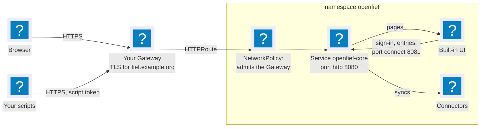

OpenFief exposes nothing on its own. Every Service it creates is a ClusterIP Service, reachable only inside the cluster, and one port of one of them is the way in: `openfief-core` in the namespace `openfief`, port `8080`, named `http`. The core is the only entry point for browsers and scripts: it serves the read API itself and passes browser pages on to the view plugin that serves them, such as the built-in UI (D-81). So whatever route you add points at that one Service port, and nothing else in the namespace is ever exposed (D-28).

The core listens on a second port too, `connect` (`8081`), which serves the plugins and nothing else: the core's NetworkPolicy admits plugin pods to it alone, and no route ever points at it (D-115).

This page shows the three usual ways in: a [Gateway API](../glossary.md#other-terms-and-abbreviations) HTTPRoute, the modern default, which OpenFief ships as an optional component; an Ingress; and `kubectl port-forward`, for a laptop with no route at all.



## What a route exposes

A route points at the core's `http` port, which serves browsers and scripts. Everything on it is behind authentication except what a sign-in needs:

| Path | Served by | Needs |
|---|---|---|
| `/v1/...` | The read API, REST ([Read API](../concepts/read-api.md)) | A session or a script token |
| `/openfief.views.v1.ReadService/...` | The read API, Connect | A session or a script token |
| `/healthz`, `/readyz` | The core's probes | Nothing; they return no data |
| Every other path | The one view plugin that holds a browser path, such as the built-in UI at `/`, when the path is under it | A session, except the sign-in and enrollment pages |

The services only plugins call, sign-in and the owner's entries such as statement uploads, are on the core's `connect` port alone, so no route reaches them: on `http` they answer 404 (D-115). Plugins themselves are never reachable from a route either: each plugin's NetworkPolicy admits the core alone (D-59), and the core proxies a browser only to the one view whose browser path the owner approved; the `openfief` CLI and the operator refuse a second (D-114).

## Passkeys need HTTPS and a known origin

You sign in with a passkey (D-26). Browsers allow passkeys only in a secure context: HTTPS, or `http://localhost`. So a route on your own hostname needs TLS, which your Gateway or Ingress terminates, for example with a certificate from cert-manager.

A passkey also works only on the hostname it was made for (D-60), and the core accepts a browser only from an origin on its allow-list, the `--auth-origin` flag, repeated once per origin. The default allows `http://localhost:8080`, for a port-forward. Add your own origin with a patch in your kustomize overlay:

```yaml
patches:
  - target:
      kind: Deployment
      name: openfief-core
    patch: |-
      - op: add
        path: /spec/template/spec/containers/0/args/-
        value: --auth-origin=https://fief.example.org
```

The Gateway component below adds this patch for you.

## Option 1: the Gateway API component

[Gateway API](https://gateway-api.sigs.k8s.io/) is the Kubernetes networking API that succeeds Ingress. The split is the point: whoever runs the cluster runs a Gateway, which listens on a port and holds the TLS certificate, and each application attaches an HTTPRoute to it for its hostname. OpenFief brings the HTTPRoute; the Gateway is yours, shared with everything else you run.

OpenFief ships the route as an optional kustomize component, [deploy/gateway](../../deploy/gateway/kustomization.yaml), outside its install bases (D-28). It adds three things, each with a placeholder you replace:

- [httproute.yaml](../../deploy/gateway/httproute.yaml): the HTTPRoute `openfief`, every path of your hostname to `openfief-core` port `8080` (`http`). The placeholders are the Gateway (`gateway` in the namespace `gateway-system`, listener `https`) and the hostname (`openfief.invalid`, a name that can never resolve).
- [networkpolicy.yaml](../../deploy/gateway/networkpolicy.yaml): a NetworkPolicy that admits the Gateway's data plane to the core's port `8080` alone, just as the demo's [core-from-traefik.yaml](../../deploy/demo/openfief/core-from-traefik.yaml) admits Traefik. The core's own policy admits only plugin pods, on `connect`. The placeholder admits every pod in the namespace `gateway-system`.
- A patch that adds `--auth-origin=https://openfief.invalid` to the core.

An overlay of your own lists OpenFief's bases, adds the component and puts in your names. Here, in a directory `fief` next to OpenFief's `deploy` directories (or with the same paths as remote kustomize URLs), for the Gateway `home` in the namespace `gateway`, the hostname `fief.example.org`, and Envoy Gateway, whose proxies run in `envoy-gateway-system` with the label `app.kubernetes.io/component: proxy`:

```yaml
apiVersion: kustomize.config.k8s.io/v1beta1
kind: Kustomization
resources:
  - ../crds
  - ../operator
  - ../egress-proxy
  - ../core
components:
  - ../gateway
patches:
  # Your Gateway and hostname.
  - target:
      kind: HTTPRoute
      name: openfief
    patch: |-
      - op: replace
        path: /spec/parentRefs/0/name
        value: home
      - op: replace
        path: /spec/parentRefs/0/namespace
        value: gateway
      - op: replace
        path: /spec/hostnames/0
        value: fief.example.org
  # Your Gateway's data plane: here Envoy Gateway's proxies.
  - target:
      kind: NetworkPolicy
      name: openfief-core-from-gateway
    patch: |-
      - op: replace
        path: /spec/ingress/0/from/0
        value:
          namespaceSelector:
            matchLabels:
              kubernetes.io/metadata.name: envoy-gateway-system
          podSelector:
            matchLabels:
              app.kubernetes.io/component: proxy
# The core accepts your browser on the route's hostname: copy it into the component's --auth-origin.
replacements:
  - source:
      kind: HTTPRoute
      name: openfief
      fieldPath: spec.hostnames.0
    targets:
      - select:
          kind: Deployment
          name: openfief-core
        fieldPaths:
          - spec.template.spec.containers.[name=core].args.[=--auth-origin=https://openfief.invalid]
        options:
          delimiter: //
          index: 1
```

`kustomize build fief` then renders the install with the route; [gateway.test.sh](../../scripts/tests/gateway.test.sh) builds exactly this overlay on every `task test`. The Gateway's listener must accept routes from the namespace `openfief`, through its `allowedRoutes`.

Some implementations don't proxy from a pod you can select. Cilium's Gateway, for one, proxies through Envoy on each node, whose traffic Cilium marks with a reserved identity instead of a pod's labels; follow your implementation's guide for admitting it, and drop the component's NetworkPolicy with a `$patch: delete`.

## Option 2: an Ingress

An Ingress does the same job in one resource, with the controller's annotations for TLS. The [demo's route](../../deploy/demo/routes/openfief.yaml) is a complete example: one host, every path to `openfief-core` on port `http`, and a certificate from cert-manager. It needs the same two companions as an HTTPRoute: the origin on the allow-list, and a NetworkPolicy that admits the Ingress controller's pods to port `8080`.

## Option 3: a port-forward, for a laptop

With no route at all, `kubectl port-forward` tunnels the Service to your own machine through the Kubernetes API, using your kubeconfig. It needs no NetworkPolicy, since it enters through the kubelet, and `http://localhost:8080` is a secure context and on the default allow-list:

```bash
kubectl -n openfief port-forward svc/openfief-core 8080:http
```

## The first passkey

A fresh install has no passkey, so the CLI prints a one-time link to create the first one ([Identity](../concepts/identity.md#the-first-passkey)). Give it your origin, which must be on the core's allow-list, and the link is for your own hostname, through your route; without one, the command starts the port-forward above itself and the link is for `localhost` (D-80):

```bash
openfief enroll --origin https://fief.example.org   # through your route
openfief enroll                                     # through a port-forward to localhost:8080
```

Each hostname gets its own passkey: once you are signed in on one, the settings page issues an enrollment link for another (D-60).

## Checking it

```bash
curl -fsS https://fief.example.org/readyz          # the core answers through your route
curl -fsS -o /dev/null -w '%{http_code}\n' https://fief.example.org/v1/accounts   # 401: the API wants a token
```

Then open `https://fief.example.org`: the sign-in page comes from the built-in UI, through the core.
