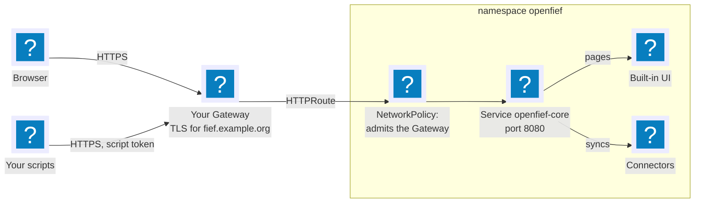

OpenFief exposes nothing on its own. Every Service it creates is a ClusterIP Service, reachable only inside the cluster, and one of them is the way in: `openfief-core` in the namespace `openfief`, port `8080`, named `http`. The core is the only entry point for browsers and scripts: it serves the read API itself and passes browser pages on to the view plugin that serves them, such as the built-in UI (D-81). So whatever route you add points at that one Service, and nothing else in the namespace is ever exposed (D-28).

This page shows the three usual ways in: a [Gateway API](../glossary.md#other-terms-and-abbreviations) HTTPRoute, the modern default; an Ingress; and `kubectl port-forward`, for a laptop with no route at all.



## What a route exposes

Everything the core serves on its `http` port, all of it behind authentication except what a sign-in needs:

| Path | Served by | Needs |
|---|---|---|
| `/v1/...` | The read API, REST ([Read API](../concepts/read-api.md)) | A session or a script token |
| `/openfief.views.v1.ReadService/...` | The read API, Connect | A session or a script token |
| Other `/openfief.*` paths | The core's services for view plugins, such as sign-in | A view plugin's own token, which browsers never hold |
| `/healthz`, `/readyz` | The core's probes | Nothing; they return no data |
| Every other path | The view plugin whose granted browser path covers it, such as the built-in UI at `/` | A session, except the sign-in and enrollment pages |

Plugins themselves are never reachable from a route: each plugin's NetworkPolicy admits the core alone (D-59), and the core proxies a browser only to a path the owner approved in that plugin's grant.

## Passkeys need HTTPS and a known origin

You sign in with a passkey (D-26). Browsers allow passkeys only in a secure context: HTTPS, or `http://localhost`. So a route on your own hostname needs TLS, which your Gateway or Ingress terminates, for example with a certificate from cert-manager.

A passkey also works only on the hostname it was made for (D-60), and the core accepts a browser only from an origin on its allow-list, the `--auth-origin` flag, repeated once per origin. The default allows `http://localhost:8080`, for a port-forward. Add your own origin with a patch in your kustomize overlay:

```yaml
patches:
  - target:
      kind: Deployment
      name: openfief-core
    patch: |-
      - op: add
        path: /spec/template/spec/containers/0/args/-
        value: --auth-origin=https://fief.example.org
```

## Option 1: a Gateway API HTTPRoute

[Gateway API](https://gateway-api.sigs.k8s.io/) is the Kubernetes networking API that succeeds Ingress. The split is the point: whoever runs the cluster runs a Gateway, which listens on a port and holds the TLS certificate, and each application attaches an HTTPRoute to it for its hostname. OpenFief brings the HTTPRoute; the Gateway is yours, shared with everything else you run.

OpenFief ships the route as an optional kustomize component (D-28). Until that component is published, apply the same two manifests yourself. The HTTPRoute sends `fief.example.org` to the core:

```yaml
apiVersion: gateway.networking.k8s.io/v1
kind: HTTPRoute
metadata:
  name: openfief
  namespace: openfief
spec:
  parentRefs:
    - name: home              # your Gateway
      namespace: gateway      # and its namespace
      sectionName: https      # its HTTPS listener
  hostnames:
    - fief.example.org
  rules:
    - backendRefs:
        - name: openfief-core
          port: 8080
```

The Gateway's listener must accept routes from the namespace `openfief`, through its `allowedRoutes`.

Then let the Gateway's proxy reach the core. The core's own NetworkPolicy admits only plugin pods, so a route needs a second policy that admits the Gateway's data plane, just as the demo's [core-from-traefik.yaml](../../deploy/demo/openfief/core-from-traefik.yaml) admits Traefik. The labels depend on your Gateway implementation; with Envoy Gateway, for example:

```yaml
apiVersion: networking.k8s.io/v1
kind: NetworkPolicy
metadata:
  name: openfief-core-from-gateway
  namespace: openfief
spec:
  podSelector:
    matchLabels:
      app.kubernetes.io/name: openfief-core
  policyTypes: [Ingress]
  ingress:
    - from:
        - namespaceSelector:
            matchLabels:
              kubernetes.io/metadata.name: envoy-gateway-system
          podSelector:
            matchLabels:
              app.kubernetes.io/component: proxy
      ports:
        - protocol: TCP
          port: 8080
```

Some implementations don't proxy from a pod you can select. Cilium's Gateway, for one, proxies through Envoy on each node, whose traffic Cilium marks with a reserved identity instead of a pod's labels; follow your implementation's guide for admitting it.

## Option 2: an Ingress

An Ingress does the same job in one resource, with the controller's annotations for TLS. The [demo's route](../../deploy/demo/routes/openfief.yaml) is a complete example: one host, every path to `openfief-core` on port `http`, and a certificate from cert-manager. It needs the same two companions as an HTTPRoute: the origin on the allow-list, and a NetworkPolicy that admits the Ingress controller's pods.

## Option 3: a port-forward, for a laptop

With no route at all, `kubectl port-forward` tunnels the Service to your own machine through the Kubernetes API, using your kubeconfig. It needs no NetworkPolicy, since it enters through the kubelet, and `http://localhost:8080` is a secure context and on the default allow-list:

```bash
kubectl -n openfief port-forward svc/openfief-core 8080:http
```

## The first passkey

A fresh install has no passkey, so the CLI prints a one-time link to create the first one ([Identity](../concepts/identity.md#the-first-passkey)). Give it your origin, and the link is for your own hostname; without one, the command starts the port-forward above itself and the link is for `localhost` (D-80):

```bash
openfief enroll --origin https://fief.example.org   # through your route
openfief enroll                                     # through a port-forward to localhost:8080
```

`--origin` is not in the CLI yet; until it is, create the first passkey on `localhost`, then sign in there and issue an enrollment link for your hostname from the settings page (D-60). Either way, each hostname gets its own passkey.

## Checking it

```bash
curl -fsS https://fief.example.org/readyz          # the core answers through your route
curl -fsS -o /dev/null -w '%{http_code}\n' https://fief.example.org/v1/accounts   # 401: the API wants a token
```

Then open `https://fief.example.org`: the sign-in page comes from the built-in UI, through the core.
