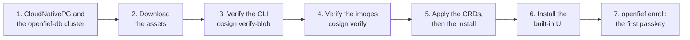

Every OpenFief release, an alpha included, ships everything an install needs as assets of its GitHub release, and the first release is an alpha. This guide installs one on a cluster of your own, with synthetic or real data, and checks every file and image it runs against the identity of OpenFief's release pipeline before anything reaches the cluster.

An alpha is a GitHub pre-release, so the releases page lists it, but `latest` never points at it: name its version. The examples use `2026.11.0-alpha.1`; use the version you are installing.

| Asset | What it is |
|---|---|
| `openfief-crds-<version>.yaml` | The `openfief` namespace and the `Plugin` and `PluginGrant` custom resource definitions, the part a cluster admin applies (D-15) |
| `openfief-install-<version>.yaml` | The operator, the egress proxy and the core, each image pinned to the digest the release signed (D-17) |
| `openfief-<version>-<os>-<arch>` | The `openfief` CLI for `linux` and `darwin` (macOS) on `amd64` and `arm64` |
| `openfief-<version>.cdx.json` | The CLI's software bill of materials, in CycloneDX |
| `openfief-<version>-SHA256SUMS` | The checksums of the CLI files and the SBOM |
| `<file>.sigstore.json` | The keyless cosign signature of each CLI file, the SBOM and the checksums |
| `openfief-docs-<version>.tar.gz` | These docs as of the release, to read offline |



## Before you start

- **A Kubernetes cluster** whose network plugin enforces NetworkPolicy, since every OpenFief component runs behind one: k3s and kind do out of the box. The end-to-end tests install each release's bundle on k3s and on kind.
- **kubectl**, with a kubeconfig that is a cluster admin for step 5's CRDs, and that has `get` and `list` on pods and `create` on `pods/exec` and `pods/portforward` in `openfief` for `openfief enroll`.
- **cosign** 3 or later, the version the release signs with, to verify the signatures ([sigstore/cosign](https://github.com/sigstore/cosign)).
- **The GitHub CLI** (`gh`), or `curl`, to download the assets.
- **Encryption at rest.** OpenFief keeps credentials in Kubernetes Secrets and leaves their encryption to the cluster (D-29): turn on etcd encryption at rest (k3s: `--secrets-encryption`), and keep the database's disks and backups encrypted.

## 1. Install CloudNativePG and the database

OpenFief keeps its record in PostgreSQL run by [CloudNativePG](https://cloudnative-pg.io) (D-14). The release bundle doesn't install either: the install expects a CloudNativePG cluster named `openfief-db` in the namespace `openfief`, and reads its connection string from the Secret `openfief-db-app` that CloudNativePG creates for it. Install the operator first, at the version the end-to-end tests run, and wait for it:

```bash
kubectl apply --server-side -f https://github.com/cloudnative-pg/cloudnative-pg/releases/download/v1.30.1/cnpg-1.30.1.yaml
kubectl -n cnpg-system rollout status deployment/cnpg-controller-manager --timeout=5m
```

The cluster itself goes into the `openfief` namespace, which the CRDs file creates, so you apply it in step 5. Save it now as `openfief-db.yaml`. This is the smallest that works, one instance on the cluster's default storage class; size it, and add CloudNativePG's backups, to suit your cluster:

```yaml
apiVersion: postgresql.cnpg.io/v1
kind: Cluster
metadata:
  name: openfief-db
  namespace: openfief
spec:
  instances: 1
  storage:
    size: 10Gi
  bootstrap:
    initdb:
      database: openfief
      owner: openfief
```

## 2. Download the assets

```bash
VERSION=2026.11.0-alpha.1
OS=linux     # or darwin
ARCH=amd64   # or arm64
gh release download "$VERSION" --repo arkadiuss/openfief \
  --pattern "openfief-crds-$VERSION.yaml" --pattern "openfief-install-$VERSION.yaml" \
  --pattern "openfief-$VERSION-$OS-$ARCH" --pattern "openfief-$VERSION-$OS-$ARCH.sigstore.json" \
  --pattern "openfief-$VERSION-SHA256SUMS" --pattern "openfief-$VERSION-SHA256SUMS.sigstore.json"
```

Without `gh`, each asset is at `https://github.com/arkadiuss/openfief/releases/download/$VERSION/<asset>`.

## 3. Verify the CLI

The release workflow, `release.yml`, signs every CLI file keylessly in the run that published the release, and only the repository owner can publish one, only from `main`. So a CLI file is genuine when its signature's certificate names exactly that workflow on `main`, issued to GitHub Actions. Check the binary and the checksums file, then the checksum:

```bash
for f in "openfief-$VERSION-$OS-$ARCH" "openfief-$VERSION-SHA256SUMS"; do
  cosign verify-blob --bundle "$f.sigstore.json" \
    --certificate-identity https://github.com/arkadiuss/openfief/.github/workflows/release.yml@refs/heads/main \
    --certificate-oidc-issuer https://token.actions.githubusercontent.com \
    "$f"
done
sha256sum --check --ignore-missing "openfief-$VERSION-SHA256SUMS"   # macOS: shasum -a 256 --check --ignore-missing
```

Each `cosign` call prints `Verified OK`, and the checksum `OK`. Anything else, stop: the file isn't what the release published. Then put the CLI on your `PATH`:

```bash
install -m 0755 "openfief-$VERSION-$OS-$ARCH" ~/.local/bin/openfief
```

## 4. Verify the images

The install file names each image by the digest the release signed, so what you verify is exactly what the cluster will run. The images are signed by a different workflow from the CLI: `images.yml`, which the release workflow calls to build them, and the certificate names the workflow that signed, so this identity is `images.yml` on `main`. It is the same identity the operator trusts for first-party plugins:

```bash
sed -n 's/^ *image: *//p' "openfief-install-$VERSION.yaml" | sort -u |
  while read -r image; do
    cosign verify "$image" \
      --certificate-identity https://github.com/arkadiuss/openfief/.github/workflows/images.yml@refs/heads/main \
      --certificate-oidc-issuer https://token.actions.githubusercontent.com >/dev/null &&
      echo "verified $image"
  done
```

It takes every image the file runs and prints `verified` for three of them, the operator, the egress proxy and the core, each as `ghcr.io/arkadiuss/openfief/<name>@sha256:<digest>`. An image it doesn't print, or one named by a tag rather than a digest, means the file isn't the one the release signed.

## 5. Apply the CRDs, the database and the install

In this order: the CRDs file creates the namespace the database and the install go into, and the core waits for its database.

```bash
kubectl apply --server-side -f "openfief-crds-$VERSION.yaml"
kubectl apply --server-side -f openfief-db.yaml
kubectl -n openfief wait cluster.postgresql.cnpg.io/openfief-db --for=condition=Ready --timeout=10m
kubectl apply --server-side -f "openfief-install-$VERSION.yaml"
for d in openfief-operator egress-proxy openfief-core; do
  kubectl -n openfief rollout status "deployment/$d" --timeout=5m
done
```

Nothing is exposed outside the cluster: every Service is a ClusterIP (D-28). [Expose OpenFief](expose.md) adds a route when you want one.

## 6. Install the built-in UI

The UI is a plugin like any other ([Built-in UI](../concepts/ui.md)), and the passkey pages are its pages, so install it before the first passkey. The CLI embeds the release's catalog, which pins each first-party plugin to the digest the release signed (D-88), so a catalog name is enough. It shows what the UI's signed manifest requests and asks you to confirm:

```bash
openfief plugin install ui
```

## 7. Create the first passkey

```bash
openfief enroll
```

It forwards `localhost:8080` to the core, prints a one-time link such as `http://localhost:8080/enroll#code=ofenroll_...`, valid for 15 minutes, and keeps forwarding until Ctrl-C (D-60, D-80). Open the link on the same machine and create the passkey; that signs you in, and the first-run wizard takes you on to your first account. A passkey works only on the hostname it was made on, so with a route of your own, make the first one there instead: `openfief enroll --origin https://fief.example.org`, for an origin the core allows ([Expose OpenFief](expose.md)).

## What next

- [Expose OpenFief](expose.md): reach the install from your browser and scripts without a port-forward.
- [Import an XTB account](xtb.md), and the other connectors in the catalog, with `openfief plugin install <name>` ([Plugins](../concepts/plugins.md)).
- [Script the read API](read-api.md).

From the first release on, every change to stored data ships with a migration of what is already stored (D-161), so a later release keeps the record this one starts. Verify each release's assets the same way before you apply them.
