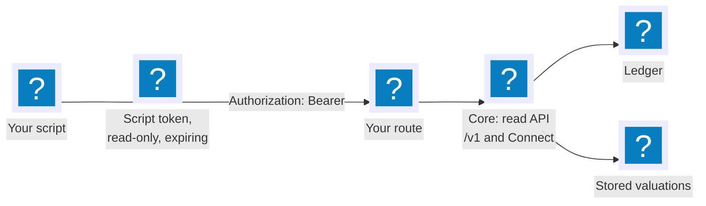

Everything the built-in UI shows comes from the [read API](../concepts/read-api.md), and your scripts get the same API: REST with JSON under `/v1`, and the same service over Connect, gRPC and gRPC-Web for generated clients. It is read-only by construction: every method is a `GET` with no side effects, and nothing you call can change the record (D-6).



## 1. Create a script token

Sign in as the owner and open **Settings**. Under **Script tokens**, give the token a name, such as `monthly-report`, and the number of days it stays valid, then choose **Create script token**. The page shows the secret, `ofs_...`, once; OpenFief stores only its hash. The same table lists your tokens and revokes one.

Script tokens can only read, and only an owner session can create them; no token is installed in advance (D-27, D-67). Keep the token out of files in a repository: read it into your shell instead.

```bash
read -rs OPENFIEF_TOKEN && export OPENFIEF_TOKEN
export OPENFIEF=https://fief.example.org     # your route, or http://localhost:8080 through a port-forward
```

## 2. Call it with curl

```bash
curl -fsS -H "Authorization: Bearer $OPENFIEF_TOKEN" "$OPENFIEF/v1/accounts"
curl -fsS -H "Authorization: Bearer $OPENFIEF_TOKEN" "$OPENFIEF/v1/accounts/<account-id>/holdings?date=$(date +%F)"
curl -fsS -H "Authorization: Bearer $OPENFIEF_TOKEN" "$OPENFIEF/v1/allocation?date=$(date +%F)&by=ALLOCATION_DIMENSION_SLEEVE"
curl -fsS -H "Authorization: Bearer $OPENFIEF_TOKEN" "$OPENFIEF/v1/performance"
curl -fsS -H "Authorization: Bearer $OPENFIEF_TOKEN" "$OPENFIEF/v1/valuation-status"
```

The [Read API](../concepts/read-api.md#concepts) page lists every method with its path and parameters, and the [OpenAPI document](../../gen/openapi/openfief/views/v1/read_service.openapi.yaml) describes them for any client generator.

Transactions come in pages: pass the `nextPageToken` of one answer as `pageToken` to get the next, until an answer has none.

```bash
curl -fsS -H "Authorization: Bearer $OPENFIEF_TOKEN" "$OPENFIEF/v1/accounts/<account-id>/transactions?pageSize=500"
```

## 3. Handle money as decimals

Every amount is a `Money` object: `amount` as a decimal string, such as `"5000.00"`, and `currency` as its ISO 4217 code. It is a string on purpose: most JSON parsers turn numbers into binary floats, which can't hold every decimal amount exactly. Parse amounts with a decimal type, never a float:

```bash
curl -fsS -H "Authorization: Bearer $OPENFIEF_TOKEN" "$OPENFIEF/v1/allocation?date=$(date +%F)&by=ALLOCATION_DIMENSION_CURRENCY" \
  | python3 -c 'import json, sys, decimal
a = json.load(sys.stdin)
for g in a.get("groups", []):
    print(g["key"], decimal.Decimal(g["valueReporting"]["amount"]), g["valueReporting"]["currency"])'
```

Every amount also keeps its original currency. Totals, valuations and the allocation add a value in the reporting currency, in fields named `valueReporting` and `totalReporting` ([Valuation](../concepts/valuation.md)). A holding that couldn't be valued on a date is listed in the allocation's `unvalued`, never silently counted as zero.

## 4. Or use the generated Go client

The SDK module `github.com/arkadiuss/openfief/sdk/go` ships the service's generated Connect client, the same contract the core serves:

```go
package main

import (
	"context"
	"fmt"
	"net/http"
	"os"

	"connectrpc.com/connect"

	viewsv1 "github.com/arkadiuss/openfief/sdk/go/gen/openfief/views/v1"
	"github.com/arkadiuss/openfief/sdk/go/gen/openfief/views/v1/viewsv1connect"
)

func main() {
	bearer := connect.UnaryInterceptorFunc(func(next connect.UnaryFunc) connect.UnaryFunc {
		return func(ctx context.Context, req connect.AnyRequest) (connect.AnyResponse, error) {
			req.Header().Set("Authorization", "Bearer "+os.Getenv("OPENFIEF_TOKEN"))
			return next(ctx, req)
		}
	})
	client := viewsv1connect.NewReadServiceClient(http.DefaultClient, os.Getenv("OPENFIEF"),
		connect.WithInterceptors(bearer))

	res, err := client.ListAccounts(context.Background(), connect.NewRequest(&viewsv1.ListAccountsRequest{}))
	if err != nil {
		fmt.Fprintln(os.Stderr, err)
		os.Exit(1)
	}
	for _, a := range res.Msg.GetAccounts() {
		fmt.Println(a.GetId(), a.GetName(), a.GetSleeve())
	}
}
```

Clients in other languages come from the same [protobuf definitions](../../proto/openfief/views/v1/read_service.proto) with Buf, or from the OpenAPI document.

## When a call fails

Errors carry fixed texts, never your data, and a request ID you can find in the core's log:

| Status | Means |
|---|---|
| 401 | No token, or one that is unknown, expired or revoked |
| 404 | No such account, or the model portfolio is off |
| 400 | A malformed date, page token or parameter; the text says which |
| 405 | Anything but `GET` over REST: the API has no writes |
| 503 | The installed plugins can't be read right now |
