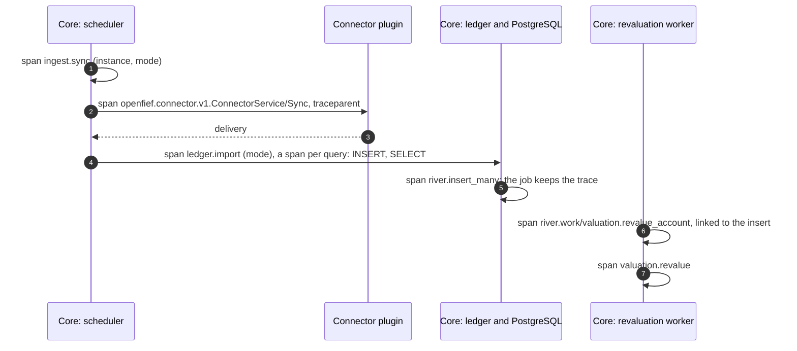

OpenFief can send [OpenTelemetry](https://opentelemetry.io/) traces of what it does, a sync from the core through a connector into the ledger and the revaluation queue, to a collector you run, such as the OpenTelemetry Collector, Grafana Tempo or Jaeger. Tracing is off until you name a collector: without one, OpenFief records nothing and opens no connection for it. You turn it on with the standard OpenTelemetry environment variables, so any collector that speaks OTLP works.

Tracing is off until the owner sets an OTLP endpoint, and every exporter passes an allow-list of span attributes, so no amount, identifier or token leaves (D-172). A database span carries the operation's name, never the statement or its arguments (D-173). What D-172 and D-173 add beyond that is [not built yet](#not-built-yet).

## What a trace shows

Each request, call, query and job gets a span, and spans of one operation share a trace across processes: the core passes the trace on in a W3C `traceparent` header to every plugin it calls, and a plugin built on the [Go SDK](../../sdk/go/telemetry/doc.go) passes it back on its calls to the core.



| Span | Where | Says |
|---|---|---|
| A Connect procedure, such as `openfief.views.v1.ReadService/ListAccounts`, or the HTTP method | Every request to the core's two ports and to a plugin, every call from the core to a plugin and from a plugin to the core | The method, the route, the status code |
| `ingest.sync`, `ingest.import_file`, `ingest.import_bond_lots` | A connector sync, a statement upload, bond lots entered by hand | The instance and the mode |
| `ledger.import` | The ledger importing a batch | Import, seed or opening lots |
| `SELECT`, `INSERT`, ... | Each query run inside one of the above | The operation and, on failure, its SQLSTATE |
| `river.insert_many`, `river.work/<kind>` | A revaluation job queued, then worked; the work links back to what queued it | The job's kind, queue, attempt and outcome |
| `valuation.revalue` | One account's revaluation | Nothing but its timing |
| `operator.reconcile` | The operator reconciling a plugin, a grant or the signing keys | The controller |

The health probes are not traced. A request to the core's browser port always starts a new trace, linked to whatever trace the caller sent, so no browser or script can choose a trace or force one to be sampled. The core drops a browser's trace headers before it passes the request to the view plugin. Calls from a plugin to the internet, through the egress proxy, are not traced, and no trace context ever leaves the cluster.

## What never leaves

Traces leave your cluster for a collector you may not run yourself, so they follow the rule for logs (GR-12): never an amount, a quantity, a price or rate, an account number, an ISIN, a token, a session, a passkey, a secret or a query's arguments. Two things enforce it:

- **What is recorded.** Spans are named by operation, never by a path that may hold an ID. Queries are recorded without their statement, their arguments or the connection's details. Jobs are recorded without their arguments.
- **What is exported.** Every span passes [`telemetry.Redact`](../../sdk/go/telemetry/redact.go) on its way out: it keeps only an allow-list of attributes, the ones in the table above, and drops everything else, URLs, paths, addresses, user agents, headers and statements included. It keeps a failed span's error status but drops the error's message, which may quote data, and keeps an exception's type but not its message.

A test drives a sync, a refused sync whose error quotes an account, calls to both of the core's ports with tokens and cookies, queries with arguments and a revaluation job through the same pipeline, and fails on any exported key or value shaped like the data above ([Verification](#verification)).

## Turn it on

The core and the operator read the standard variables. Set them in their containers' environment:

| Variable | Default | Meaning |
|---|---|---|
| `OTEL_EXPORTER_OTLP_ENDPOINT` | none: tracing off | The collector's base URL, `http://` or `https://`; over HTTP the spans go to its `/v1/traces` |
| `OTEL_EXPORTER_OTLP_TRACES_ENDPOINT` | none | The full URL for spans, used as it is; wins over the one above |
| `OTEL_EXPORTER_OTLP_PROTOCOL` | `http/protobuf` | `http/protobuf` (port 4318 by convention) or `grpc` (4317) |
| `OTEL_EXPORTER_OTLP_HEADERS` | none | Headers sent with every export, such as an API key, as `key=value` pairs separated by commas |
| `OTEL_TRACES_SAMPLER` | `parentbased_always_on` | `always_on`, `always_off`, `traceidratio`, or `parentbased_` with any of these |
| `OTEL_TRACES_SAMPLER_ARG` | `1` | The ratio samplers' share of traces kept, from 0 to 1 |
| `OTEL_SERVICE_NAME` | `openfief-core`, `openfief-operator` | The service's name in each span |
| `OTEL_RESOURCE_ATTRIBUTES` | none | More resource attributes, such as `deployment.environment.name=home` |
| `OTEL_SDK_DISABLED`, `OTEL_TRACES_EXPORTER` | | `true`, or `none`, turn export off whatever else is set |

A value OpenFief can't use stops it at start with an error naming the variable, never its value, since an endpoint or a header may hold a credential: a typo never silently turns tracing off or sends spans somewhere else. The exporters also honor the standard timeout, compression and certificate variables. Spans go straight to the collector, never through a proxy, in batches; on shutdown the core and the operator send what is still buffered, for up to five seconds.

### With the tracing component

OpenFief ships an optional kustomize component, [deploy/tracing](../../deploy/tracing/kustomization.yaml), outside its install bases. It adds:

- [configmap.yaml](../../deploy/tracing/configmap.yaml): the ConfigMap `openfief-tracing`, which the core and the operator read as their environment. Its placeholder endpoint, `http://otel-collector.observability.invalid:4318`, can never resolve. Add any other variable from the table as a key.
- A patch that reads that ConfigMap into both containers, and `OTEL_EXPORTER_OTLP_HEADERS` from the key `headers` of a Secret `openfief-tracing`, when you create one.
- [networkpolicy.yaml](../../deploy/tracing/networkpolicy.yaml): the core's NetworkPolicy allows only DNS, the database, plugins and the Kubernetes API, so this one adds the collector's ports 4317 and 4318. The placeholder allows every pod in the namespace `observability`. The operator has no NetworkPolicy.

An overlay of your own lists OpenFief's bases, adds the component and puts in your collector. Here, in a directory `fief` next to OpenFief's `deploy` directories, for a collector `otel-collector` in the namespace `monitoring`, keeping a quarter of the traces:

```yaml
apiVersion: kustomize.config.k8s.io/v1beta1
kind: Kustomization
resources:
  - ../crds
  - ../operator
  - ../egress-proxy
  - ../core
components:
  - ../tracing
patches:
  # Your collector and sampling.
  - target:
      kind: ConfigMap
      name: openfief-tracing
    patch: |-
      - op: replace
        path: /data/OTEL_EXPORTER_OTLP_ENDPOINT
        value: http://otel-collector.monitoring:4318
      - op: add
        path: /data/OTEL_TRACES_SAMPLER
        value: parentbased_traceidratio
      - op: add
        path: /data/OTEL_TRACES_SAMPLER_ARG
        value: "0.25"
  # Only your collector's pods.
  - target:
      kind: NetworkPolicy
      name: openfief-core-to-collector
    patch: |-
      - op: replace
        path: /spec/egress/0/to/0
        value:
          namespaceSelector:
            matchLabels:
              kubernetes.io/metadata.name: monitoring
          podSelector:
            matchLabels:
              app.kubernetes.io/name: otel-collector
```

A collector that wants a credential gets it from the Secret, never from the ConfigMap or the overlay:

```sh
kubectl -n openfief create secret generic openfief-tracing --from-literal=headers='authorization=Bearer <your collector token>'
```

The core and the operator read their environment at start, so restart them after a change: `kubectl -n openfief rollout restart deploy/openfief-core deploy/openfief-operator`.

## Plugins

A plugin built on the Go SDK traces its connector calls and its calls to the core with no work of its own: `ServeConnector` starts its tracing, and a view that serves its own port, such as the built-in UI, calls `openfief.StartTelemetry`. The operator doesn't give plugins the variables above, so a plugin exports nothing: its NetworkPolicy and the egress proxy keep it from any collector. D-172 has plugins send their spans to the core, which applies the same allow-list and exports them; that is [not built yet](#not-built-yet). The trace still passes through it, so the core's spans before and after a plugin call stay one trace.

## Verification

- `TEST-telemetry-config`: the configuration is off by default, takes the endpoint, protocol, headers and sampler from the standard variables, and refuses each bad value without quoting it.
- `TEST-telemetry-redact`: the exporter's filter keeps only allowed attributes, drops error messages and keeps span names.
- `TEST-telemetry-export`: with an endpoint, spans reach an OTLP receiver only when shutdown flushes them, redacted; without one, nothing records; the server handler continues the caller's trace and the public one doesn't.
- `TEST-core-tracing-privacy`: the core's and the SDK's tracing carry a trace from the core to a plugin and from a job's queueing to its work, and no exported span holds an amount, an account number, an ISIN, an IBAN, a token, a session or a query argument.
- `TEST-deploy-tracing-component`: the overlay above builds, sets the variables on the core and the operator and admits the core to the collector alone, and the bases alone set no tracing variable.

## Not built yet

- Plugins sending their spans to the core, which exports them through the same allow-list (D-172); today plugins export nothing.
- Metrics over OTLP through the same allow-list (D-172); today only traces are exported, and logs stay on standard output, as D-172 keeps them.
- Spans of calls through the egress proxy with their host, status and duration only, never the path or query (D-173); today those calls aren't traced.
