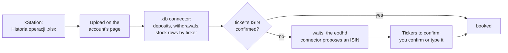

XTB offers no API for a retail account, so OpenFief reads the export xStation writes: the "Historia operacji" (operation history) workbook, one account per file (D-9, R-24). The first-party `xtb` connector maps it, and you upload it in the built-in UI. It needs no egress and no Secret: the file is all it reads.

The export names each instrument by its ticker and market, such as `TESTA.PL`, never by ISIN. OpenFief needs an ISIN for every instrument (D-35), so the first time a ticker appears, the market-data connector looks it up and proposes one, and you confirm it once (D-116). Until you do, that ticker's rows wait, left out of the ledger.

## Before you start

- An owner session in the built-in UI (passkey sign-in).
- The `xtb` plugin installed, for example `openfief plugin install xtb`, and an account bound to it: create it on the **Accounts** page with the instance as its connector ([Ingest](../concepts/ingest.md#the-owners-accounts)).
- For ISIN proposals, the `eodhd` plugin with your API key ([Valuation](../concepts/valuation.md)). Without it, you type each ISIN yourself.

## 1. Export the history

In xStation, open the account's operation history, choose the whole period since the account was opened, and export it to Excel. Keep the file's name as xStation writes it, `<currency>_<account>_<from>_<to>.xlsx`: the connector reads the account's currency from it, or from the `Open Positions` summary when you rename the file. Never send the file to anyone else; OpenFief stores none of it.

## 2. Upload it in transactions mode

On the account's page, under **Upload statement**, pick **transactions** as the mode and upload the file. The core would choose opening mode for an account not yet seeded (D-109), but an xStation export can't seed one: it holds no cash balance and no cost of your positions in the account's currency, so the connector refuses an opening upload and says why. Uploading the whole history in transactions mode books every deposit, buy, sale and dividend from the first deposit on, so cash and holdings add up.

The first upload names the XTB account it found. If it says the broker account isn't mapped, pick it for this account on the **Accounts** page (D-72) and upload the file again. The XTB account number is kept only for that mapping; the read API never serves it (D-121).

## 3. Confirm the tickers

The upload's result lists the rows left out. Rows that wait for a ticker's ISIN say so, and the result links **Tickers to confirm**. That page lists each ticker with its name at XTB, how many rows wait, and the ISIN the market-data connector proposed, already filled in.

- Check the proposal against the instrument's documents or the exchange's site, then press **Confirm**.
- When no proposal is shown, type the ISIN and press **Save**. A US listing never gets a proposal: the market-data connector covers European exchanges only (D-51).

Each confirmation books that ticker's waiting rows at once and holds for every later upload. It can't be changed afterwards, so check it first.

## 4. Upload again whenever you like

Upload a newer export at any time; every row is keyed by XTB's operation ID, so rows already booked stay unchanged (D-18), and only new ones are added.

## What is and isn't imported

| Row | Imported as |
|---|---|
| `Deposit`, `Withdrawal` | A deposit or withdrawal of cash. Its comment, which names your bank or account, is never read. |
| `Stock purchase`, `Stock sell` of a stock or ETF | A buy or sale of the ticker, its units from the comment and its cost or proceeds in the account's currency, once the ticker is confirmed |
| `Dividend` with its `Withholding tax` | A dividend of the ticker with the tax withheld, once the ticker is confirmed |
| Open and closed CFD positions | Flagged as not supported (D-24) |
| `Free funds interest` and its tax, other types | Left out as not supported yet ([Implementation questions](../implementation-questions.md)) |

Amounts are rounded to the grosz (or the cent): the export stores them as binary floating-point numbers, and the rounding takes away their last-digit noise. An amount with a real fraction of a grosz is refused as a problem instead. [Ingest](../concepts/ingest.md#mapping-an-xstation-export) explains the mapping in detail.
