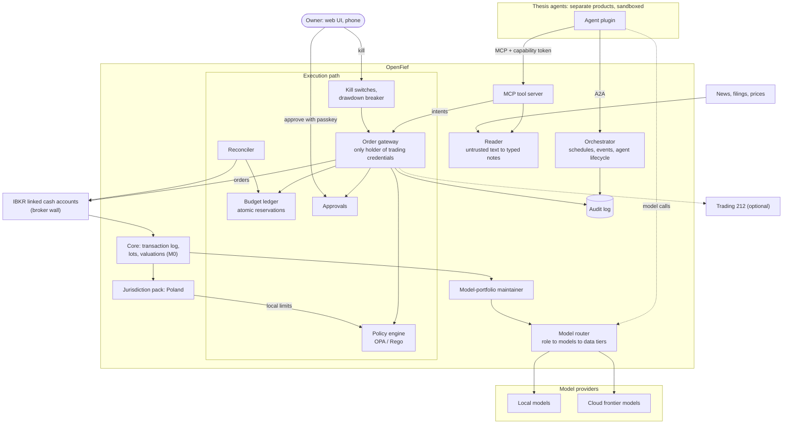

# Proposals: control plane (fiefs and execution, M1 and M3)

Not decided. When the author decides an item, it moves into [DESIGN.md](../DESIGN.md) as a decision and leaves this file.

This area turns GR-6 (a lease per agent, with strong guarantees) and GR-7 (agents have tools to make transactions) into enforcement that does not depend on any model's behaviour.

## Target architecture

How the M1 to M3 pieces would sit around the decided M0 core. Agent-side pieces are in [agents-and-models.md](agents-and-models.md).



## Lease enforcement

- **[P-11] Layered enforcement for GR-6.**
  - (a) Broker wall: one IBKR linked cash account (no margin) per offensive sleeve.
  - (b) Only an order gateway holds broker trading credentials. Agents hold scoped capability tokens (Biscuit or macaroon style: instruments, side, max notional, expiry).
  - (c) A budget ledger reserves notional atomically before submission.
  - (d) A pre-trade policy engine (OPA/Rego): allow-lists, limit orders only, price bands, rate limits, no leverage, liquidity filters such as a minimum ADV.
  - (e) Tiered human approval; a new thesis or a lease increase always needs approval.
  - (f) Kill switches per agent, per sleeve and global, plus a drawdown circuit breaker.
- **[P-12] Lease accounting basis.** A fief's usage is the reserved notional of its open intents and orders, plus the cost basis of its open positions, plus fees. Market gains do not create buying power. Sale proceeds return to the fief's available balance up to the lease amount; anything above the lease is swept back to the offensive sleeve. Losses shrink what the agent can redeploy until a lease top-up is approved. This gives GR-6 one number the ledger can enforce atomically. Whether market value should count instead is OQ-11.
- **[P-13] Reserve before approval.** The ledger reserves an intent's notional as soon as the policy engine allows it, before any human approval, and releases it on denial, expiry, cancellation or kill. The human only ever approves a trade that is already funded within the lease, and two approvals cannot race past it.
- **[P-14] Fail closed.** If the ledger, the policy engine, the audit log or the reconciliation state is unavailable or stale, the gateway rejects every new intent. Cancellations still go through.
- **[P-15] Reconciliation.** The gateway compares the ledger with the broker's cash, positions and open orders after every fill and on a schedule. Any unexplained difference (a manual trade, a corporate action, a fee, a missed fill) suspends the affected fief and emits a lease-breach event.
- **[P-16] Authentic approvals.** Approvals happen in OpenFief's web UI, installable on a phone as a PWA, and need a passkey signature (D-26) bound to the hash of the specific intent. Push, e-mail or chat notifications carry only a link, never an approve action. Approvals expire.
- **[P-17] Kill freezes, never liquidates.** A kill revokes capability tokens, cancels working orders and suspends every fief in its scope. Selling positions is a separate, explicit owner action, because automatic liquidation, triggered in a panic or by an attacker, can do more damage than a freeze. Open: OQ-16.
- **[P-18] Audit log.** An append-only, hash-chained log of every intent, policy decision with policy version, approval, order, fill, lease change and kill. Each decision also records the thesis version, input source tags, model and provider per role, and prompt and response hashes. OpenFief on one's own account is not an investment firm, but this is the record needed to debug, or stop trusting, an agent (see R-8 for what regulators expect of firms).
- **[P-19] Dedicated account for broker-wall-only agents.** An agent whose only protection is the broker wall gets its own linked account (one fief per account), so the broker bounds that fief rather than a whole sleeve.
- **[P-20] Guarantee level per agent.** Show each agent's guarantee level: "gateway + broker" or "broker wall only". An IBKR-native agent bypasses the gateway, so it only gets the broker wall.

What each layer stops:

| Layer | Stops | Does not stop |
|---|---|---|
| Broker wall | Losses beyond that account's cash, even if the OpenFief host is fully compromised | Bad trades within that cash; several fiefs sharing one account (T-7) |
| Capability token | Trading outside its instruments, side, max notional or expiry | Many small allowed orders adding up |
| Budget ledger | Reservations plus positions exceeding the lease, including concurrent intents | Drift from the broker (P-15 handles it) |
| Policy engine | Market orders, prices outside bands, rate abuse, leverage, illiquid instruments | Well-formed bad ideas |
| Human approval | Autonomous surprises, new theses, lease increases | Approval fatigue; spoofed approvals (P-16 handles them) |
| Kill switches and drawdown breaker | Further damage once noticed or once the drawdown limit is hit | Losses before detection |
| Reconciliation | Silent drift between ledger and broker | Drift between two reconciliation runs |
| Fail closed | Trading while a control is down | Nothing beyond the layers above |

Only the broker wall survives a compromise of the OpenFief host; every other layer runs on that host.

## Capital and venues

- **[P-21] Capital by track record.** Allocate capital the way multi-manager funds run "pods": paper trading first, then a small live lease, then scale up or cut.
- **[P-22] Execution venues.** IBKR is the primary execution venue; Trading 212 is optional (R-4). XTB, mBank and Revolut stay read-only, imported.
- **[P-23] Event and ledger store for M1.** NATS JetStream for events, and an atomic compare-and-set reservation for the budget ledger. Because M0 already runs Postgres (D-14), the reservation could instead be one conditional update in the same transaction as the intent row; TigerBeetle's pending transfers are a third option. Decide at M1.

## Lifecycles and entities

- **[P-24] Fief lifecycle.**

  ```mermaid
  stateDiagram-v2
    [*] --> proposed: owner or agent proposes thesis and lease
    proposed --> approved: owner approves
    proposed --> closed: rejected or withdrawn
    approved --> active: token issued, lease opened in ledger
    approved --> closed: not activated before expiry
    active --> active: lease change approved
    active --> suspended: kill, lease breach, drawdown breaker, reconciliation mismatch
    suspended --> active: owner re-approves
    active --> revoked: owner revokes
    suspended --> revoked: owner revokes
    active --> closed: thesis done, positions exited, capital returned
    suspended --> closed: positions exited, capital returned
    revoked --> [*]
    closed --> [*]
  ```

  - **proposed:** no token, no reservation. A new thesis always needs approval.
  - **active:** the only state in which the agent's token is valid.
  - **suspended:** token invalid, working orders cancelled, positions kept. Every transition out needs the owner.
  - **revoked:** authority withdrawn for good; remaining positions pass to the owner, outside any fief.
  - **closed:** orderly end; capital is back in the offensive sleeve.

- **[P-25] Intent, order and fill lifecycle.** Each fill, partial or final, moves its notional from reserved to committed in the ledger. On cancellation only the unfilled remainder is released. A reconciliation mismatch at any point raises a lease-breach event.

  ```mermaid
  stateDiagram-v2
    state "Intent submitted" as submitted
    state "Intent rejected" as rejected
    state "Intent reserved" as reserved
    state "Intent awaiting approval" as awaiting
    state "Reservation released" as released
    state "Order routed" as routed
    state "Order working" as working
    state "Order partially filled" as partial
    state "Order filled" as filled
    state "Order cancelled" as cancelled
    state "Fill committed to ledger" as committed
    state "Fill reconciled with broker" as reconciled

    [*] --> submitted: agent calls the submit-intent tool
    submitted --> rejected: invalid token or scope, policy deny, or ledger CAS fails
    submitted --> reserved: policy allows and ledger CAS succeeds
    reserved --> awaiting: approval tier needs the owner
    reserved --> routed: approval tier allows auto-approval
    awaiting --> routed: approved with passkey
    awaiting --> released: denied, expired or killed
    routed --> working: broker accepts
    routed --> released: broker rejects
    working --> partial: partial fill
    partial --> partial: further partial fill
    working --> filled: complete fill
    partial --> filled: final fill
    working --> cancelled: agent cancel, kill or expiry
    partial --> cancelled: remainder cancelled
    cancelled --> released: unfilled notional released
    filled --> committed: reservation becomes position cost
    committed --> reconciled: matches broker
    rejected --> [*]
    released --> [*]
    reconciled --> [*]
  ```

- **[P-26] Control-plane entities.**

  | Entity | Key attributes |
  |---|---|
  | Fief | Lease amount and currency, used and available (P-12), state (P-24), token scope, approval tier, stage (paper or live), guarantee level, backing account |
  | Intent | Fief, instrument, side, quantity or notional, limit price, time in force, thesis version, invalidation conditions, source references, token ID |
  | Order | Broker order ID, account, limit price, quantity, state (P-25) |
  | Fill | Order, quantity, price, fees, time |
  | PolicyDecision | Allow, deny or needs approval; matched rule IDs; policy version; ledger reservation ID |
  | Approval | Intent or fief change, decision, passkey assertion, expiry |
  | CapabilityToken | Fief, instruments, sides, max notional, expiry |
  | AuditEvent | Sequence, time, actor, action, subject, payload hash, previous event hash |

## Security model

### Thesis agent: execution

- **Data seen:** the agent's own fief (lease, cash, positions, working orders), its thesis, and public data through the reader. Never the whole portfolio, never another fief.
- **Threats:** the agent, or text injected into it, tries to exceed its lease; concurrent intents race the budget; the agent obtains broker credentials; rapid-fire or manipulative orders; thinly traded instruments that are easy to move; spoofed approvals or approval fatigue; gateway bugs; the ledger drifting from the broker; compromise of the OpenFief host.
- **Controls:** P-11 to P-17. The broker wall bounds the loss if the host is compromised.

### Third-party or IBKR-native agent

- **Data seen:** whatever the third-party platform sees; for an IBKR-native agent, every IBKR account it is connected to. OpenFief cannot scope it.
- **Models:** chosen by the third party. The owner exercises GR-11 by choosing the agent, not the model behind it.
- **Threats:** the gateway, ledger and policy engine are bypassed; holdings data flows to the third party.
- **Controls:** guarantee level "broker wall only" (P-20), a dedicated linked account funded with exactly the fief (P-19), and reconciliation through a read connector, which detects overshoot but cannot prevent it (P-15).

## Milestones

- **[P-27] M1 acceptance criteria: control plane on paper trading.** No language model is involved; test agents are scripted. Execution uses an IBKR paper account through the same connector, plus an in-process simulated broker for deterministic tests.
  1. A scripted agent with a 5,000 PLN fief sends 50 concurrent intents whose total exceeds the lease. Accepted notional never exceeds the lease, across repeated runs.
  2. Intents outside the token's scope (instrument, side, notional, expiry) are rejected. Market orders are rejected. Intents breaching price bands, rate limits or minimum ADV are rejected. Each rejection has a PolicyDecision naming the rule.
  3. The agent process holds no broker credentials and has no network route to the broker or the internet.
  4. Stopping the ledger, the policy engine or the audit log makes the gateway reject all new intents, while cancellations still work.
  5. Kill at agent, sleeve and global scope revokes tokens and sends cancellations for all working orders within 5 seconds, and sells nothing.
  6. A manual trade placed directly in the paper account is caught by reconciliation and suspends the affected fief.
  7. A new fief and a lease increase each require approval. Approval needs a passkey, a notification alone cannot approve, and approvals expire.
  8. The audit log reconstructs intent, decision, approval, order and fill for every test case, and its hash chain verifies.
  9. Every transition in P-24 and P-25 is exercised by a test.
- **[P-28] M3 acceptance criteria: first small live fief.** Preconditions: OQ-3 answered; T-5 and OQ-11 decided; the agent has passed M2 on paper for a period the author sets.
  1. One IBKR linked cash account without margin, funded only with the fief amount. The gateway is the only holder of trading credentials for it.
  2. Every live order goes through the gateway and needs owner approval for a first period the author sets.
  3. A live kill drill with a working order: the order is cancelled and the token revoked.
  4. Reconciliation is clean every day for the first 30 days, or every difference is explained in the audit log.
  5. The audit log is complete for every live order.
  6. Router and egress logs show no whole-portfolio data sent to a cloud model.
  7. Used only on the author's own account (see R-7).

## Tensions

- **[T-3] GR-6 vs GR-10.** GR-6 demands strong guarantees, but GR-10 lets the owner pick Interactive Brokers' agents, which bypass the gateway, ledger and policy engine. Proposed: P-20, and P-19 so the broker wall bounds a single fief.
- **[T-5] GR-7 vs intents only.** P-29 reads GR-7's "tools to make transactions" as the gateway's intent API, gated by a capability token, so agents never hold broker credentials or send raw broker orders. This interpretation needs the author's confirmation. If GR-7 means agents place broker orders directly, P-11 (b) to (d) no longer apply and only the broker wall remains.
- **[T-7] Broker wall per sleeve vs GR-6 per agent.** P-11 (a) puts one linked account per offensive sleeve. If several fiefs share it, the broker caps the sleeve, not each agent, and a broker-wall-only agent has no per-agent bound at all. Proposed: P-19. Depends on OQ-3 and OQ-20.
- **[T-8] Measuring GR-6 under price moves.** If a position rises, its market value exceeds the lease without any new capital. Is that a breach? Proposed: P-12. See OQ-11.
- **[T-10] What IBKR's agents can do.** GR-10 names Interactive Brokers' agents as an option, but IBKR's official MCP server only drafts orders, and the client submits them on IBKR's platform (R-3). If no IBKR agent executes by itself, a human submits every IBKR-native order and T-3 is narrower than it looks. See OQ-13.

## Open questions

- **[OQ-3]** IBKR linked-account availability and behaviour for Polish residents (served by IB Ireland).
- **[OQ-5]** Do short-term strategies need a dedicated execution engine (e.g. NautilusTrader)?
- **[OQ-11]** How is "more of the portfolio than its lease" (GR-6) measured: committed cost, current market value, or both? What happens to gains and losses: swept back to the sleeve, or kept by the fief? (T-8, P-12)
- **[OQ-13]** What exactly are "Interactive Brokers' agents" in GR-10? (T-10)
- **[OQ-16]** What does a kill do to open positions: freeze them, or liquidate? (P-17)
- **[OQ-19]** Which IBKR path should execution use: TWS API / IB Gateway, or the Client Portal Web API? Flex Queries cover reporting only.
- **[OQ-20]** Broker-wall granularity: one linked account per offensive sleeve or per fief? Is there one offensive sleeve or several? (T-7, P-19)
