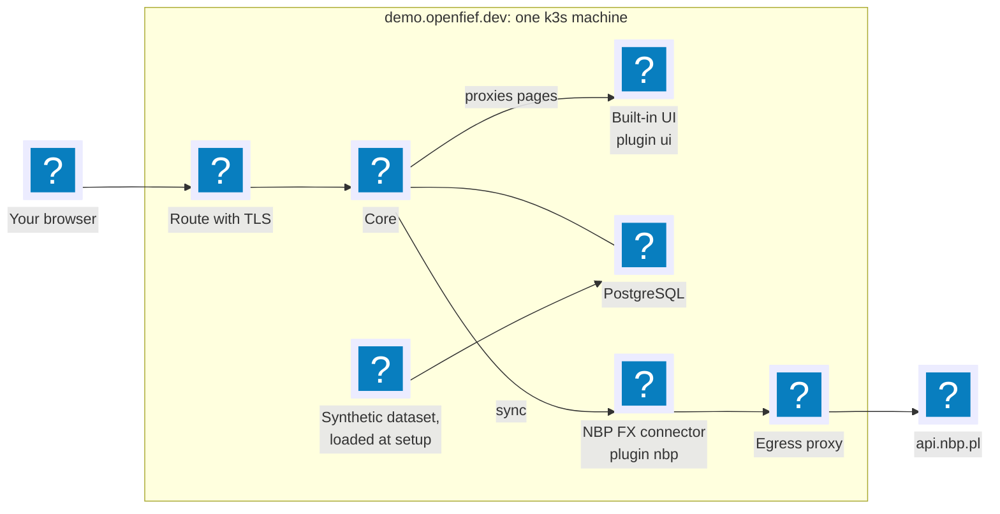

The quickest way to see OpenFief is the public demo at [demo.openfief.dev](https://demo.openfief.dev). It runs a recent build of `main` on one small k3s machine, with a generated portfolio that belongs to no one: about a year of history across two brokers and treasury bonds in an [IKE](glossary.md#other-terms-and-abbreviations). The demo keeps it valued through today, and nothing you do there changes it.

An install of your own comes with the first release. Until then, this tour shows what it will run, and [Expose OpenFief](guides/expose.md) and [Build a plugin](guides/build-a-plugin.md) show the parts you would set up.

## What you are looking at

The demo is a normal OpenFief, so the tour is also a tour of the architecture. Your browser reaches the [core](glossary.md), the only way in, through the demo's route. The core keeps the record in PostgreSQL and passes browser requests on to the built-in UI, which is a [view](glossary.md) plugin. A [connector](glossary.md) plugin fetches the National Bank of Poland's exchange rates through the egress proxy, live. The rest of the dataset was loaded by a one-off job, through the same import paths real statements take.



## 1. Sign in as a visitor

Open [demo.openfief.dev](https://demo.openfief.dev). The sign-in page offers two ways in: a passkey, for the demo's owner, and **View demo**, for everyone else. Choose **View demo**. You get a read-only session without any credentials (D-68), so you can look at everything and change nothing. On your own install there is no View demo: you sign in with a passkey ([Identity](concepts/identity.md)).

## 2. The overview

The overview answers "what do I own, and how is it doing":

- **The total** on today's date, in the reporting currency, PLN: every holding at its stored valuation, plus cash. Amounts keep their own currency everywhere else and are converted only for totals ([Valuation](concepts/valuation.md)).
- **Accounts**, one per institution account, each in a [sleeve](glossary.md): the offensive part of the portfolio, which agents will one day lease from, or the defensive part, which they never touch ([Portfolio](concepts/portfolio.md)). *Valued through* is the last day the account has stored valuations for. When a price, a rate or an import changes something, a queue revalues the affected days and the date catches up.
- **Allocation**, switchable between asset class, currency, institution and sleeve.
- **Value over time** as a time-weighted return index from go-live, 100 on the first day, so money you pay in or take out doesn't count as performance.

Everything on this page comes from the [read API](concepts/read-api.md), the same read-only API your own scripts would use. The UI computes nothing itself.

## 3. One account, all the way down

Open **Demo IBKR**:

- **Holdings**, each valued in its own currency and in PLN.
- **Cash** per currency.
- **Open lots**, oldest first, as tax lots are consumed first in, first out. Each names where it came from: an *opening lot* entered when the account was set up, or the Interactive Brokers trade that opened it, as `ibkr-flex:<account> <IBKR's own ID>`. That pair is how a re-import recognizes a transaction it has already seen ([Ledger](concepts/ledger.md)).
- **Balance assertions**: what the broker said it held on a date, matched against what the ledger derives. A mismatch means an import went wrong, and it is flagged rather than hidden.
- **Transactions** with their double-entry postings. Every transaction's postings sum to zero in each currency, so money never appears or vanishes.

Then open **Demo treasury bonds (IKE)**. Polish retail treasury bonds have no market price: each series is valued from its terms, the inflation readings and the National Bank's reference rate, and the COI series pays a yearly coupon you can see among the transactions ([Treasury bonds](concepts/treasury-bonds.md)).

## 4. The checks

Two pages collect what needs your attention: **Balance assertions** lists every flagged one, and **Price checks** lists the days when an institution's own price of an instrument differs from the price its holdings are valued at by more than 1%. An empty page is the healthy state. Both exist because a tracker that is quietly wrong is worse than none.

## 5. The plugins

**Plugins** lists the plugin instances running in the cluster:

- `nbp`, a connector: it fetches NBP's exchange rates from `api.nbp.pl`, the only host its [grant](glossary.md) allows.
- `ui`, a view: the page you are reading it on.

The **Trust** column says who signed each image, here OpenFief's CI, and the image digest says exactly which build runs. Plugins are installed, approved and removed with the `openfief` command line, never from the UI ([Plugins](concepts/plugins.md)).

## 6. From a script

The read API serves REST under `/v1` and Connect under `/openfief.views.v1.ReadService/`, described by its [OpenAPI document](../gen/openapi/openfief/views/v1/read_service.openapi.yaml). Every call needs a script token, which only the owner can create, from a signed-in session, so a visitor can't call the demo's API. On your own install, a call looks like this:

```bash
curl -fsS -H "Authorization: Bearer $OPENFIEF_TOKEN" https://fief.example.org/v1/accounts
curl -fsS -H "Authorization: Bearer $OPENFIEF_TOKEN" "https://fief.example.org/v1/allocation?date=$(date +%F)&by=ALLOCATION_DIMENSION_SLEEVE"
```

## Where next

- [How it works](architecture.md): the parts you just saw and how they fit together.
- [Expose OpenFief](guides/expose.md): how browsers and scripts reach your install.
- [Build a plugin](guides/build-a-plugin.md): write a connector or a view of your own.
- [Concepts](concepts/): each part in depth.
