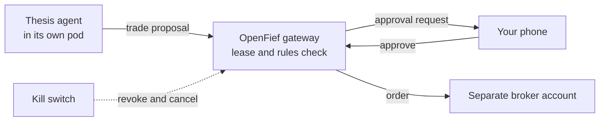

## Where it's going

OpenFief is built in milestones. The tracker comes first; the agents follow on top of it. This is the planned flow for one agent:

1. **Spawn a thesis agent.** "Company X is undervalued; three-year horizon." Give it a fief of 5,000 PLN. It sees its thesis, public data and its own fief, nothing else.
2. **It proposes a trade:** a limit order, its reasoning, and what would prove the thesis wrong. The gateway checks it against the lease and your rules.
3. **You approve it on your phone.** The order goes to a separate broker account that holds only capital set aside for agents.
4. **Pull the kill switch** if something looks off. The agent loses its trading rights, its open orders are cancelled, and the rest of your portfolio is untouched.

## Why a fief

In medieval Europe, a lord granted a vassal a fief: land to run as the vassal saw fit, held on conditions, and taken back when they broke. The vassal ruled the fief, never the kingdom. OpenFief makes the same deal with software agents, and writes the conditions in code.

Our mascot keeps the gate. Kasztan is a żubr, the bison of Białowieża, a royal forest whose bison Polish kings put under crown protection in the 16th century: a creature living inside a guarded domain, under rules it can't argue with. His name is the *kasztelan*, the castellan who kept a castle for the crown, and *kasztan*, the chestnut of his coat.

## Help shape it

The design is public, with every decision numbered and every proposal open to critique. The most useful input now is a hard look at [the security model](../../docs/DESIGN.md), and experience with the Interactive Brokers API or its linked accounts as a Polish resident. Start with the [overview](../../docs/OVERVIEW.md), then the [architecture](../../docs/architecture.md).
