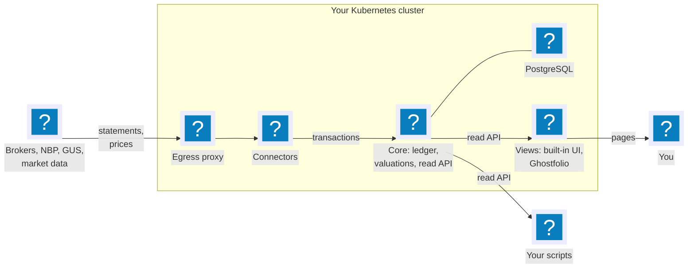
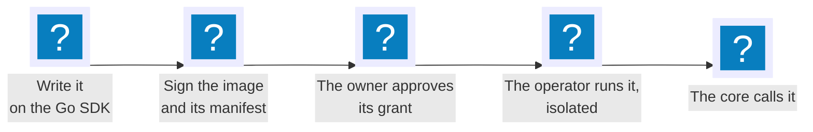
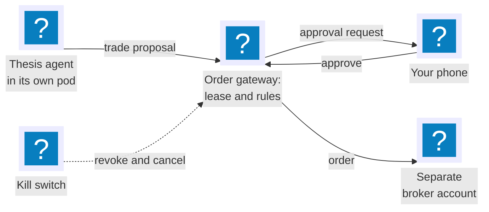

## How it works

Statements, prices and rates come in through connectors. The core keeps the record: an append-only ledger and a valuation of every holding on every day. Views show it, and your own scripts read it through the same read-only API. Each plugin runs in its own pod with only the permissions you granted, and reaches the internet only through an egress proxy that knows which hosts it may call.

[See how the parts fit together](../../docs/architecture.md), or [take the tour](../../docs/quickstart.md) of a running OpenFief.

## Build on it

OpenFief is a platform before it is an app: everything outside the core is a plugin. Connectors bring data in, views show it, and agents, later, trade inside their fief. A plugin is a container image whose signed manifest says what it needs: which hosts it calls, which Secrets it reads, what it may do. You approve exactly that, and the operator enforces it.

[Build a plugin](../../docs/guides/build-a-plugin.md) walks through a real connector, from its manifest to its signature.

## Where it's going

The tracker comes first; the agents follow on top of it. This is the planned flow for one agent:

1. **Spawn a thesis agent.** "Company X is undervalued; three-year horizon." Give it a fief of 5,000 PLN. It sees its thesis, public data and its own fief, nothing else.
2. **It proposes a trade:** a limit order, its reasoning, and what would prove the thesis wrong. The gateway checks it against the lease and your rules.
3. **You approve it on your phone.** The order goes to a separate broker account that holds only capital set aside for agents.
4. **Pull the kill switch** if something looks off. The agent loses its trading rights, its open orders are cancelled, and the rest of your portfolio is untouched.

## Why a fief

In medieval Europe, a lord granted a vassal a fief: land to run as the vassal saw fit, held on conditions, and taken back when they broke. The vassal ruled the fief, never the kingdom. OpenFief makes the same deal with software agents, and writes the conditions in code.

Our mascot keeps the gate. Kasztan is a żubr, the bison of Białowieża, a royal forest whose bison Polish kings put under crown protection in the 16th century: a creature living inside a guarded domain, under rules it can't argue with. His name is the *kasztelan*, the castellan who kept a castle for the crown, and *kasztan*, the chestnut of his coat.
